<div align="center">
   
</div>

<div align="center">


</div>

---

> **Note:** This project was built with AI assistance to develop faster. The emphasis is on higher-level architecture and design thinking: the architecture and design decisions were made by the team, and AI was used to speed up the implementation.

## About

Distributed Hazard Platform is the BNPB side of a disaster-information exchange. Two independent sources publish hazard data in different formats and with different authentication: **BMKG** (earthquakes and tsunami warnings, static API key) and **PVMBG** (volcanic reports, OAuth with a one-time code and rotating tokens). Both are mocks in this repository. BNPB polls them, maps everything into one canonical `HazardEvent`, serves it to Media, Tim Lapangan and Operator clients with per-role field access, and fans every new event out to independent consumers through RabbitMQ.

## Architecture

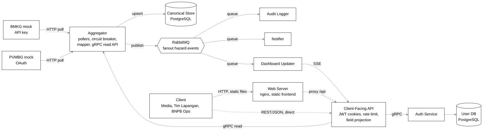

Every box except the client is its own container. The nginx container serves the static frontend and proxies `/api/*` to the Client-Facing API, which keeps the page and the API on one origin; the API can also be called directly on its own port. Each database is reachable only by its owner (`canonical-store` by the Aggregator, `user-db` by the Auth Service). The Client-Facing API is the only public API and the only place a JWT is verified. Jaeger and Prometheus sit beside the stack for traces and metrics.

| Service | Role |
|:---|:---|
| `bmkg-mock`, `pvmbg-mock` | The two external sources, with injected latency, an outage switch and a schema switch |
| `aggregator` | One poller per source, circuit breaker, mapping to `HazardEvent`, upsert to the Canonical Store, event publishing, gRPC read API |
| `canonical-store` | PostgreSQL with a JSONB `attributes` column, so unknown source fields need no migration |
| `auth-service`, `user-db` | Login, refresh, logout, registration, accounts; salted password hashes |
| `client-facing-api` | Public REST API, JWT in HttpOnly cookies, transparent refresh, token-bucket rate limit, global concurrency cap, per-role field projection |
| `rabbitmq` | Fanout exchange `hazard.events`, one durable queue per consumer |
| `dashboard-updater`, `notifier`, `audit-logger` | Independent consumers, each with its own dedup store |
| `web-frontend` | SvelteKit static app served by nginx, which also proxies `/api/*` |
| `jaeger`, `prometheus` | Traces (the trace ID is the `correlation_id` in logs) and request metrics |

## Tech stack

| Layer | Technology |
|:---|:---|
| Services | Go, one module per service, tied by `go.work` |
| Service-to-service | gRPC from the Client-Facing API to the Aggregator and the Auth Service, AMQP through RabbitMQ |
| Public API | REST over HTTP, JWT HS256 in HttpOnly cookies |
| Storage | PostgreSQL (Canonical Store, User DB) |
| Broker | RabbitMQ, fanout exchange, durable queues, publisher confirms |
| Live updates | Server-Sent Events from the Dashboard Updater through the Client-Facing API |
| Frontend | SvelteKit (`adapter-static`) served by nginx |
| Observability | OpenTelemetry, Jaeger, Prometheus, structured JSON logs with a correlation ID |
| Orchestration | Docker Compose |
| Tests | Go tests, shell scenario scripts, k6 load test |

## What it solves

Each problem is solved in the code and reproduced by a script in `tests/scenarios/`. The steps are under [Test scenarios](#test-scenarios-problems-1-to-5).

### Problem 1: the source changes its schema and nothing restarts

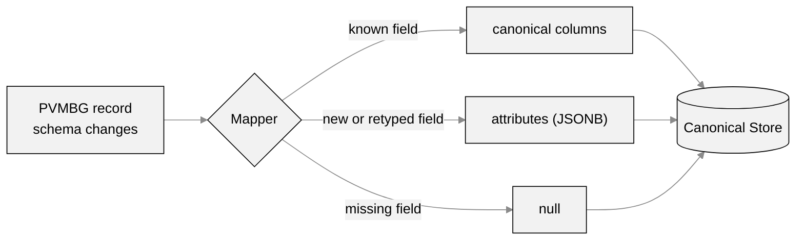

- Unknown fields go to a JSONB `attributes` column, so the table never needs a migration and the Aggregator never restarts.
- Old rows stay as they were. A field that changes meaning, or a moved endpoint, is a documented limit.

---

### Problem 2: a slow or failing source must not drag the others down

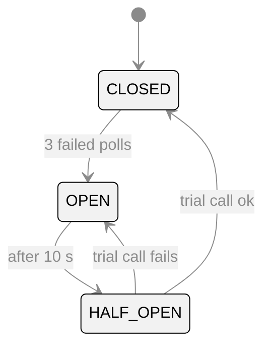

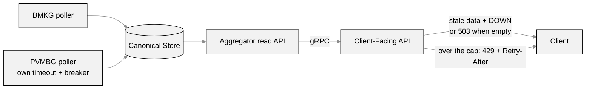

- One poller, timeout and circuit breaker per source. Reads come from the store, so an outage costs freshness and not availability.
- Overload is shed on purpose: a global concurrency cap, a token bucket per account, and a cap on the gRPC read API.

---

### Problem 3: authentication and per-field access

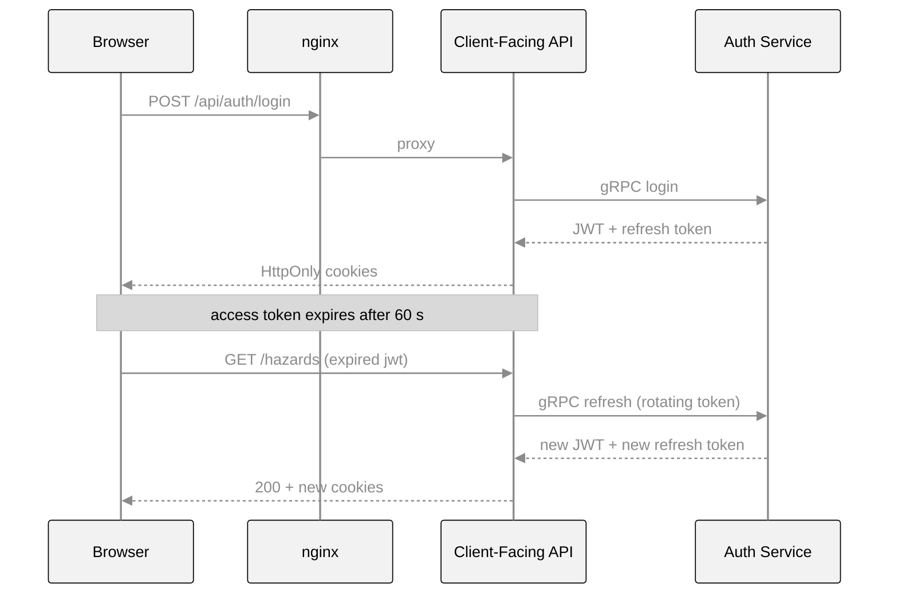

| Role | Fields | Accounts |
|:---|:---|:---|
| Media | summary only, 403 on raw fields | none |
| Tim Lapangan | all | none |
| Operator | all | can create |

- BMKG takes a static key. PVMBG uses OAuth with a one-time code and rotating opaque tokens that the Aggregator renews by itself.
- Only the Client-Facing API verifies the JWT.

---

### Problem 4: independent services and storage ownership

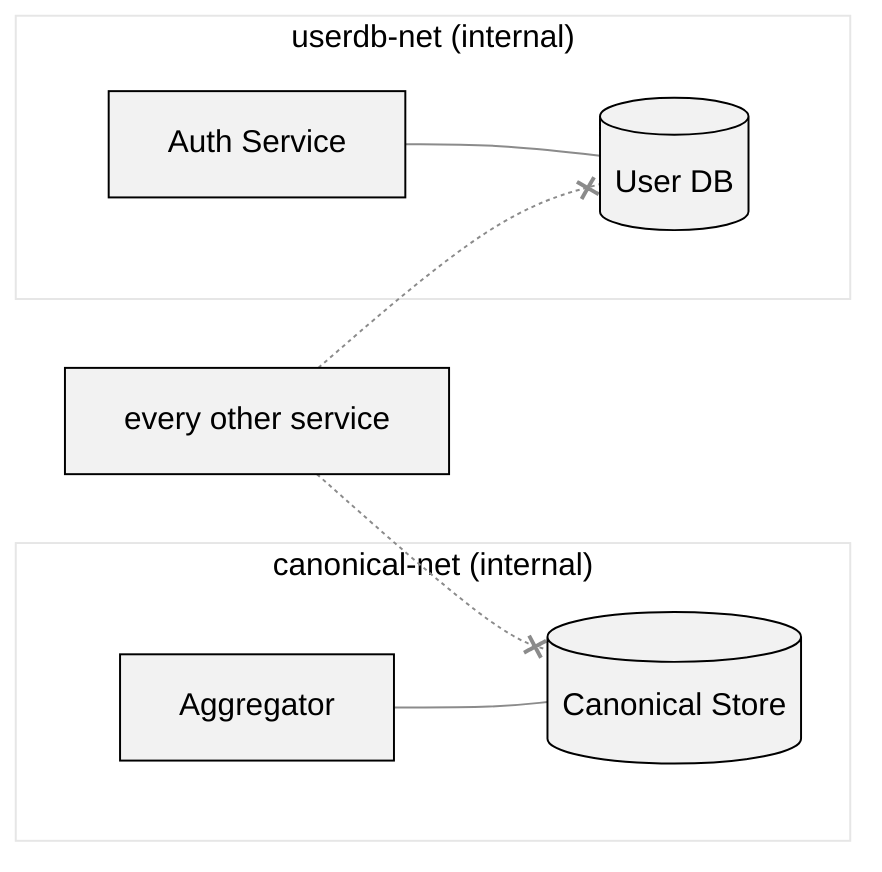

- Every component is its own container and image, with a `/health` that reports depth. One can be stopped, rebuilt and restarted while the rest keep running.
- Each database is reachable only by its owner and publishes no host port.

---

### Problem 5: event fan-out to independent consumers

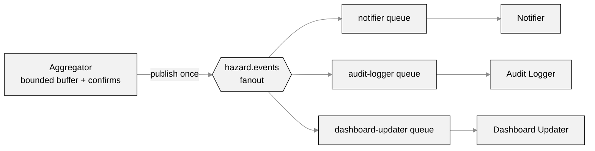

- One publish reaches every consumer through its own durable queue. A stopped consumer's queue keeps the backlog and it catches up on return, while the others carry on.
- Consumers acknowledge after processing (at-least-once), so each one deduplicates. A new consumer only declares a queue on the exchange, with no change to the producer.

## Screenshots

Taken from a local `docker compose up` with the example `.env`.

<div align="center">

**Login**

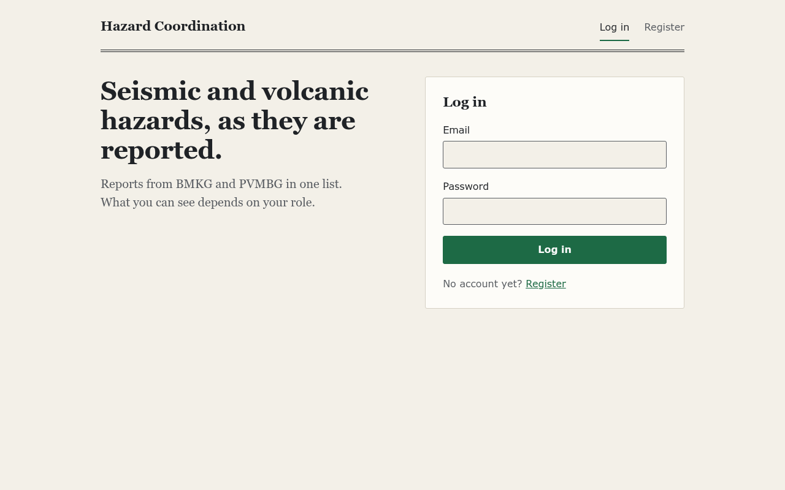

Log in with the seeded Operator, or with an account created through Register.

<br/>

**Hazards, Seismic tab (BMKG)**

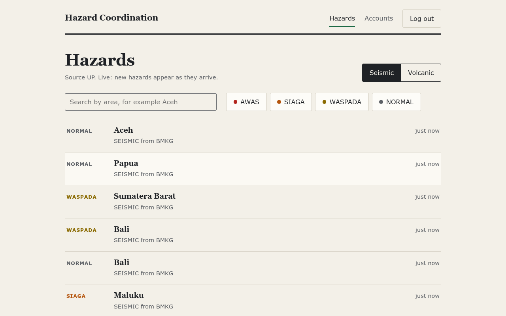

Live list from the Client-Facing API with a severity filter and search.

<br/>

**Hazards, Volcanic tab (PVMBG)**

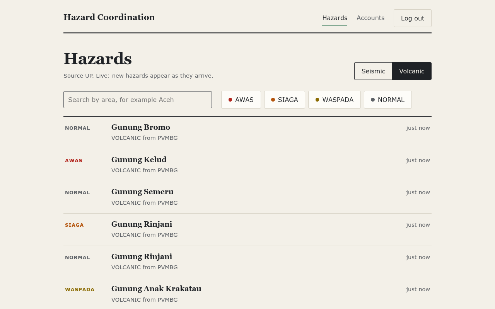

The same list for PVMBG reports.

<br/>

**Create an account (Operator only)**

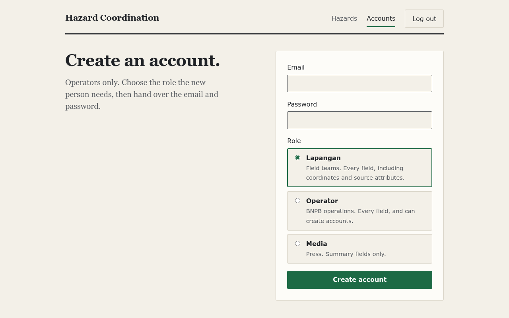

The chosen role decides which fields the API returns.

<br/>

**RabbitMQ queues**

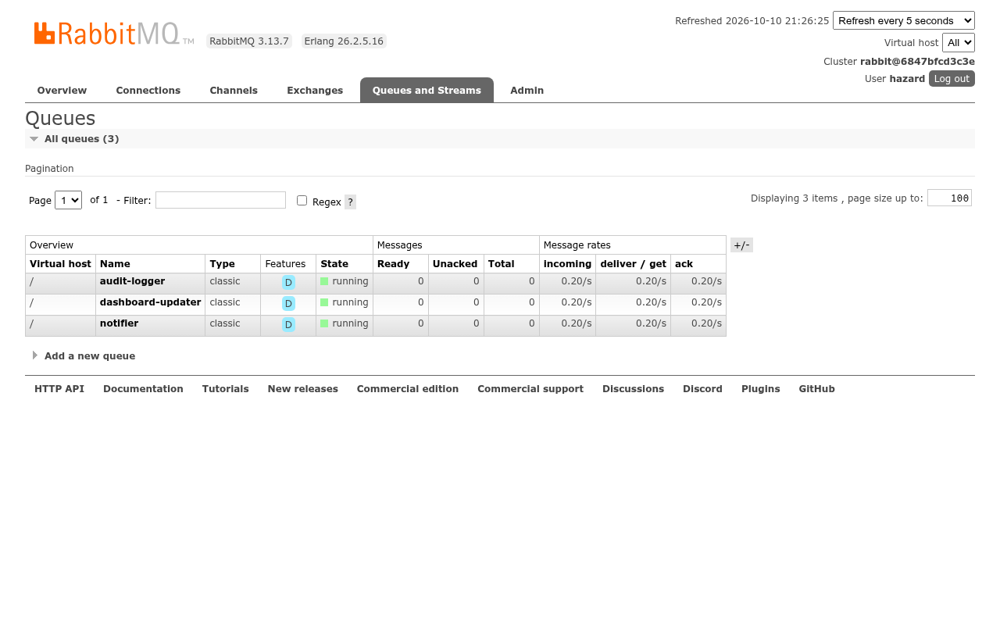

One durable queue per consumer.

<br/>

**Jaeger, recent traces**

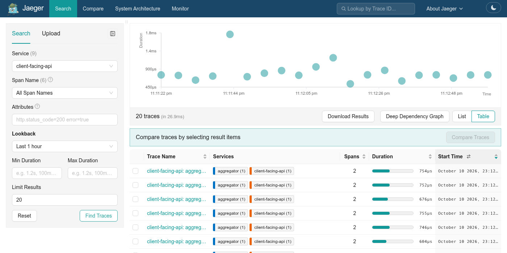

Latest Client-Facing API traces.

<br/>

**One GET /hazards end to end**

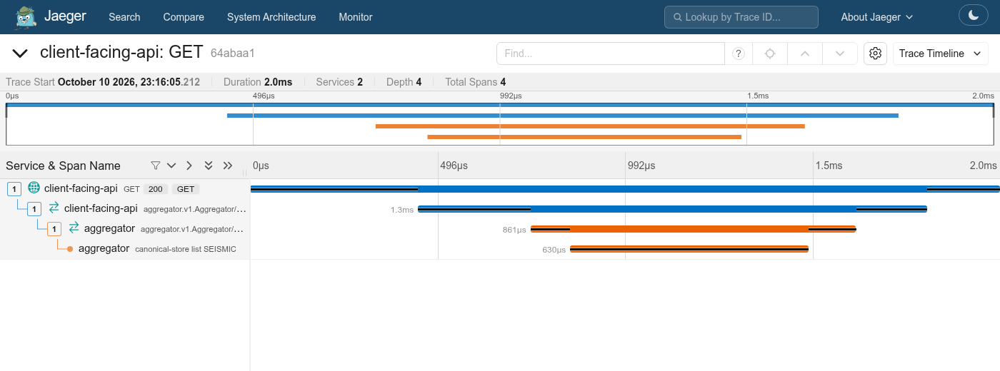

Client-Facing API, then the Aggregator over gRPC, then the Canonical Store query.

<br/>

**Jaeger Monitor**

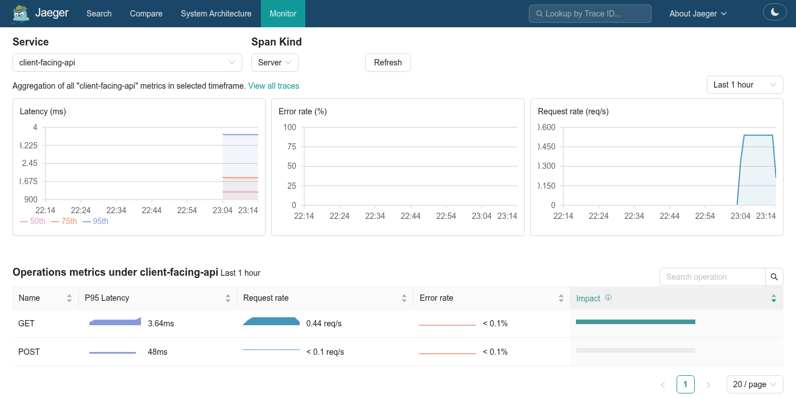

Latency, errors and request rate, read from Prometheus.

</div>

## Prerequisites

- Go 1.26+
- Docker + Docker Compose (only needed for `docker compose up`, not required to build/test an individual service)
- `git`
- `curl` and `jq`, for the copy-paste scenario commands below

How you get these on your machine is up to you, a system package manager or `asdf` both work. If you'd rather not manage them yourself, this repo happens to include a [devenv](https://devenv.sh/) config (`devenv.nix`) that pins Go, `golangci-lint`, and `gh` for you: `devenv shell` drops you into a shell with all of it on `PATH`. That's just how the maintainers set their own machines up, not something the project requires. Every command below is a plain command that works the same whether it's typed directly or inside a devenv shell.

## Run it from a clean clone

Copy the example environment. Its values work as is for a local run, and `.env` is gitignored.

```bash
git clone https://github.com/brii26/distributed-hazard-coordination.git
cd distributed-hazard-coordination
cp .env.example .env
```

Build every image. The command returns once every health check passes.

```bash
docker compose up -d --build --wait
```

Check the stack. Every service is "running", and the ones with a health check show "(healthy)".

```bash
docker compose ps
```

If one of the host ports below is already taken on your machine, change it in `.env` (`CLIENT_FACING_API_PORT`, `WEB_FRONTEND_PORT`, `BMKG_PORT`, `PVMBG_PORT`, `RABBITMQ_MANAGEMENT_PORT`); the scenario commands further down read the ports from there. The first build takes a few minutes. `--wait` returns once every container with a health check reports healthy, so when it exits the stack is ready. Stop it with `docker compose down`; add `-v` to also wipe the databases, the PVMBG token and the consumers' dedup files and start from zero.

| Port | What |
|---|---|
| <http://localhost:3000> | Web frontend (log in as `SEED_OPERATOR_EMAIL` / `SEED_OPERATOR_PASSWORD` from `.env`) |
| <http://localhost:8080> | Client-Facing API, the only public API (`/auth/*`, `/accounts`, `/me`, `/hazards`, `/health`) |
| <http://localhost:8081> | BMKG mock, to poke it directly (needs `X-BMKG-Key`) |
| <http://localhost:8082> | PVMBG mock, including the demo switches `/admin/outage` and `/admin/schema-version` (need `X-Admin-Key`) |
| <http://localhost:15672> | RabbitMQ management UI (`RABBITMQ_USER` / `RABBITMQ_PASSWORD` from `.env`) |

The Aggregator, Auth Service, both databases and the consumers publish no host port. Their health is reachable from inside the stack, for example `docker compose exec aggregator wget -qO- localhost:8091/health`; every service's `/health` answers `{"status":"ok"|"degraded"|"down",...}`.

## Repository layout

```
services/<name>/     one Go module per service (the web frontend is SvelteKit)
  go.mod
  main.go
  main_test.go
  Dockerfile
infra/<name>/        config for third-party components (no Go code), e.g. infra/rabbitmq
doc/                  design docs and the backlog dependency graph
tests/               scenarios (P1-P5), integration, smoke and load tests
docker-compose.yml    full local stack
go.work               ties all service modules together for cross-module tooling
```

Each service directory is its **own Go module** (`go.work` lists them all). This means `go build ./...`/`go test ./...` from the repo root won't work as a single command, the repo root isn't itself a module. Run per-service commands from inside `services/<name>/`, or use the loop shown below.

Every directory under `services/` is a Go module that the local checks below loop over. Config-only components such as the broker go in `infra/` so they aren't treated as one.

## Running the full stack

`docker compose up --build` (as above) waits on health checks before dependent services start: the Aggregator waits for both Postgres instances, RabbitMQ and both mocks, the Client-Facing API for the Aggregator and the Auth Service, the web frontend for the Client-Facing API.

### Checking that the databases are isolated

Each database sits on an internal network shared only with its owner: `canonical-net` (Aggregator and `canonical-store`) and `userdb-net` (Auth Service and `user-db`). Neither database publishes a host port; to look inside one, use `docker compose exec canonical-store psql -U aggregator`.

With the stack running, probe both databases from every service:

```bash
for s in aggregator auth-service bmkg-mock pvmbg-mock rabbitmq client-facing-api web-frontend dashboard-updater notifier audit-logger; do
  echo "$s  canonical-store: $(docker compose exec -T $s sh -c 'nc -zw2 canonical-store 5432 >/dev/null 2>&1 && echo reachable || echo unreachable')" \
          " user-db: $(docker compose exec -T $s sh -c 'nc -zw2 user-db 5432 >/dev/null 2>&1 && echo reachable || echo unreachable')"
done
```

Only `aggregator` reaches `canonical-store` and only `auth-service` reaches `user-db`; everything else says `unreachable`.

## Configuration reference

Every variable in `.env.example`. Compose reads `.env` and passes each one to the services listed; the default applies when the variable is unset. A variable with no default must be set (the example values are fine locally).

| Variable | Used by | Default | Meaning |
|---|---|---|---|
| `BMKG_PORT` | bmkg-mock | 8081 | Host port of the BMKG mock |
| `BMKG_API_KEY` | bmkg-mock, aggregator | none | Static key BMKG checks in `X-BMKG-Key` |
| `BMKG_SEED_COUNT` | bmkg-mock | 20 | Seismic events generated at start |
| `BMKG_EVENT_INTERVAL_S` | bmkg-mock | 10 | A new seismic event every N seconds |
| `BMKG_DELAY_MIN_MS` / `BMKG_DELAY_MAX_MS` | bmkg-mock | 50 / 150 | Injected latency per request |
| `TRACING_ENABLED` | all Go services | true | Export OpenTelemetry spans to Jaeger. A poll cycle's or request's trace ID is its `correlation_id` in the logs |
| `OTEL_EXPORTER_OTLP_ENDPOINT` | all Go services | http://jaeger:4317 | OTLP gRPC endpoint spans are sent to; Jaeger being down never affects a service |
| `JAEGER_UI_PORT` | jaeger | 16686 | Host port of the Jaeger UI, `http://localhost:16686`. Its Monitor tab shows request rate, errors and latency per service, from a Prometheus container Jaeger reads (traces stay in Jaeger's memory, metrics in Prometheus; both reset on restart) |
| `PVMBG_PORT` | pvmbg-mock | 8082 | Host port of the PVMBG mock |
| `PVMBG_OAUTH_CLIENT_ID` / `PVMBG_OAUTH_CLIENT_SECRET` | pvmbg-mock, aggregator | none | OAuth client credentials (Basic auth on `/oauth/token`) |
| `PVMBG_ONE_TIME_CODE` | pvmbg-mock, aggregator | none | Authorization code for the first token, accepted once per PVMBG lifetime |
| `PVMBG_ADMIN_KEY` | pvmbg-mock | none | `X-Admin-Key` for `/admin/outage` and `/admin/schema-version` |
| `PVMBG_DELAY_MIN_MS` / `PVMBG_DELAY_MAX_MS` | pvmbg-mock | 500 / 3000 | Injected latency per request (Problem 2) |
| `PVMBG_SEED_COUNT` | pvmbg-mock | 20 | Volcanic reports generated at start |
| `PVMBG_EVENT_INTERVAL_S` | pvmbg-mock | 10 | A new volcanic report every N seconds |
| `CANONICAL_DB_USER` / `CANONICAL_DB_PASSWORD` / `CANONICAL_DB_NAME` | canonical-store, aggregator | aggregator / none / canonical_store | Canonical Store credentials and database |
| `USER_DB_USER` / `USER_DB_PASSWORD` / `USER_DB_NAME` | user-db, auth-service | auth / none / user_db | User DB credentials and database |
| `RABBITMQ_USER`, `RABBITMQ_PASSWORD` | rabbitmq, aggregator, consumers | hazard, change-me | Broker login. The user is created at container start from these, change the password in `.env` and recreate with `docker compose down -v` |
| `RABBITMQ_MANAGEMENT_PORT` | rabbitmq | 15672 | Host port of the RabbitMQ management UI |
| `RABBITMQ_EXCHANGE` | aggregator, consumers | hazard.events | Fanout exchange name; must match `infra/rabbitmq/definitions.json` |
| `POLL_INTERVAL_MS` | aggregator | 3000 | Poll interval per source |
| `POLL_TIMEOUT_MS` | aggregator | 4000 | Timeout of one poll call |
| `CB_FAILURE_THRESHOLD` | aggregator | 3 | Failed polls in a row before the circuit breaker opens |
| `CB_OPEN_DURATION_MS` | aggregator | 10000 | How long the breaker stays open before a trial poll |
| `AGGREGATOR_MAX_INFLIGHT_REQUESTS` | aggregator | 100 | Concurrency cap of the gRPC read API (`RESOURCE_EXHAUSTED` beyond it) |
| `DB_POOL_SIZE` | aggregator | 20 | Connection pool to the Canonical Store |
| `JWT_SIGNING_SECRET` | auth-service, client-facing-api | none | Shared HMAC secret for JWTs |
| `SECRET_SALT` | user-db, auth-service | none | Salt in `sha256(password + salt)`; the User DB seed uses it too |
| `ACCESS_TOKEN_TTL_S` | auth-service, client-facing-api | 60 | Access token lifetime for every role (seconds) |
| `SEED_OPERATOR_EMAIL` / `SEED_OPERATOR_PASSWORD` | user-db, auth-service | none | The Operator account created on a fresh User DB |
| `CLIENT_FACING_API_PORT` | client-facing-api | 8080 | Host port of the public API |
| `CLIENT_FACING_API_MAX_INFLIGHT_REQUESTS` | client-facing-api | 100 | Global concurrency cap (429 + `Retry-After` beyond it) |
| `RATE_LIMIT_RPS` | client-facing-api | 50 | Token bucket per client (account) |
| `AUTH_RATE_LIMIT_RPS` | client-facing-api | 10 | Token bucket per client IP on `/auth/login` and `/auth/register` |
| `UPSTREAM_TIMEOUT_MS` | client-facing-api | 1000 | Timeout of each call to the Aggregator and the Auth Service |
| `COOKIE_SECURE` | client-facing-api | true | Mark the `jwt`/`refresh_token` cookies Secure (fine on `http://localhost`) |
| `WEB_FRONTEND_PORT` | web-frontend | 3000 | Host port of the web frontend |
| `CLIENT_FACING_API_BASE_URL` | web-frontend (build) | /api | API base the static app calls; `/api` goes through the frontend's own nginx |
| `FRONTEND_POLL_INTERVAL_MS` | web-frontend (build) | 5000 | How often the hazards page refreshes |

Fixed in `docker-compose.yml` rather than `.env`, because they only wire the containers together: internal ports (`PORT`, `GRPC_PORT` 9091/9092, `HEALTH_PORT` 8091-8095), the connection strings (`DATABASE_URL`, `USER_DB_URL`, `RABBITMQ_URL`, `BMKG_BASE_URL`, `PVMBG_BASE_URL`, `AGGREGATOR_GRPC_ADDR`, `AUTH_SERVICE_GRPC_ADDR`), each consumer's `QUEUE_NAME`, and the file paths on volumes (`PVMBG_TOKEN_VOLUME_PATH`, `DEDUP_STORE_PATH`; the Audit Logger also writes `/var/lib/audit-logger/audit.log`, its `AUDIT_LOG_PATH` default).

## Test scenarios (Problems 1 to 5)

Each problem also has a script that runs these steps and prints PASS or FAIL per check: `tests/scenarios/problem1.sh` to `problem5.sh`, or `tests/scenarios/all.sh`.

Run from the repository root with the stack up (`docker compose up -d --build --wait`). Needs `curl` and `jq`. Each block is copy-paste; the expected outcome follows it. Load the values the stack runs with and log in as the seeded Operator once:

Load the environment and the helper variables, then log in as the seeded Operator. The answer is `{"expires_in":...}` and the cookies are saved in `op.jar`.

```bash
set -a; . ./.env; set +a
API=http://localhost:${CLIENT_FACING_API_PORT:-8080}
BMKG=http://localhost:${BMKG_PORT:-8081}
PVMBG=http://localhost:${PVMBG_PORT:-8082}
login() { curl -s -c "$1.jar" -X POST $API/auth/login -d "{\"email\":\"$2\",\"password\":\"$3\"}"; echo; }
login op "$SEED_OPERATOR_EMAIL" "$SEED_OPERATOR_PASSWORD"
```

### Problem 1: schema change at the source

Read the newest volcanic reports, then switch PVMBG to the extended schema. The switch answers `{"schema_version":"extended"}`.

```bash
curl -s -b op.jar "$API/hazards?type=VOLCANIC&limit=3" | jq '[.data[] | {area_name, severity, confidence: .attributes.confidence_level}]'
curl -s -X POST $PVMBG/admin/schema-version -H "X-Admin-Key: $PVMBG_ADMIN_KEY"; echo
```

```bash
sleep 15
curl -s -b op.jar "$API/hazards?type=VOLCANIC&limit=3" | jq '[.data[] | {area_name, severity, confidence: .attributes.confidence_level}]'
docker compose ps aggregator --format '{{.Status}}'
```

Before the switch `confidence` is `null`; after it the newest reports carry a value, the older ones are still served unchanged, and the Aggregator's uptime shows it was never restarted. Switch back with the same `POST`.

The same records side by side in the Canonical Store, newest first (also the Problem 4 evidence of records before and after the change):

```bash
docker compose exec -T canonical-store psql -U "$CANONICAL_DB_USER" -d "$CANONICAL_DB_NAME" -c \
  "SELECT source_ref_id, severity, attributes ? 'confidence_level' AS has_confidence, ingested_at FROM hazard_events WHERE hazard_type = 'VOLCANIC' ORDER BY ingested_at DESC LIMIT 6"
```

`has_confidence` is `t` for the reports ingested after the switch and `f` for the ones before, all in one table with no migration.

---

### Problem 2: slow and failing source

PVMBG latency at 3 s while BMKG stays fast, then the load test:

Set the PVMBG delay, time five seismic requests, then run the k6 load test. The load test checks `bmkg_only` p95 under 300 ms, and `mixed` with 50 connections for 60 s with under 1% errors (429s not counted).

```bash
PVMBG_DELAY_MIN_MS=3000 PVMBG_DELAY_MAX_MS=3000 docker compose up -d --wait pvmbg-mock
for i in 1 2 3 4 5; do curl -s -o /dev/null -w '%{time_total}s\n' -b op.jar "$API/hazards?type=SEISMIC"; done
tests/load/run.sh
```

The seismic requests stay well under 300 ms (they never wait on PVMBG). Setting the delay recreates the PVMBG container, which forgets the tokens it issued; the Aggregator notices on its next token rotation and re-authenticates by itself (`token bootstrap fallback` in its log), so PVMBG data can take up to about a minute to come back after this step. `tests/load/run.sh` brings up its own copy of the stack, prints throughput, p50/p95/p99 and counts per status code, and fails if a threshold fails.

Outage on, stale data, recovery:

Turn the PVMBG outage on. The answer is `{"outage_active":true}`.

```bash
curl -s -X POST $PVMBG/admin/outage -H "X-Admin-Key: $PVMBG_ADMIN_KEY"; echo
```

Wait, then ask for volcanic data. `source_status` is DOWN, `stale_since` is set and the data is still served.

```bash
sleep 20
curl -s -b op.jar "$API/hazards?type=VOLCANIC&limit=1" | jq .meta
```

Ask for seismic data. BMKG is still UP.

```bash
curl -s -b op.jar "$API/hazards?type=SEISMIC&limit=1" | jq .meta
```

Turn the outage off. The answer is `{"outage_active":false}`.

```bash
curl -s -X POST $PVMBG/admin/outage -H "X-Admin-Key: $PVMBG_ADMIN_KEY"; echo
```

Wait for PVMBG to come back, then read its status. It is UP, `stale_since` is null and nothing was restarted.

```bash
for i in $(seq 90); do curl -s -b op.jar "$API/hazards?type=VOLCANIC&limit=1" | jq -e '.meta.source_status == "UP"' >/dev/null && { echo "PVMBG UP again after ${i}s"; break; }; sleep 1; done
curl -s -b op.jar "$API/hazards?type=VOLCANIC&limit=1" | jq .meta
```

With nothing stored for the source the answer is an explicit 503 instead of stale data. To see it, empty the volcanic rows while the outage is on. This deletes the stored volcanic reports (only new ones come back), so run it after the Problem 1 comparison:

Turn the outage on, wait, delete the volcanic rows and ask again. The answer is HTTP 503 with an error body.

```bash
curl -s -X POST $PVMBG/admin/outage -H "X-Admin-Key: $PVMBG_ADMIN_KEY"; echo
sleep 20
docker compose exec -T canonical-store psql -U "$CANONICAL_DB_USER" -d "$CANONICAL_DB_NAME" -c "DELETE FROM hazard_events WHERE hazard_type = 'VOLCANIC'"
curl -s -w '\nHTTP %{http_code}\n' -b op.jar "$API/hazards?type=VOLCANIC"
```

Turn the outage off again. The data comes back.

```bash
curl -s -X POST $PVMBG/admin/outage -H "X-Admin-Key: $PVMBG_ADMIN_KEY"; echo
```

Restore the normal PVMBG latency with `docker compose up -d --wait pvmbg-mock`.

---

### Problem 3: authentication and per-field access

Each source only accepts its own credentials:

No key: the answer is 401.

```bash
curl -s -o /dev/null -w 'BMKG, no key: %{http_code}\n' $BMKG/seismic-events
```

PVMBG's admin key sent to BMKG: the answer is 403.

```bash
curl -s -o /dev/null -w 'BMKG, PVMBG admin key: %{http_code}\n' -H "X-BMKG-Key: $PVMBG_ADMIN_KEY" $BMKG/seismic-events
```

BMKG key sent as a PVMBG token: the answer is 401.

```bash
curl -s -o /dev/null -w 'PVMBG, BMKG key as token: %{http_code}\n' -H "Authorization: Bearer $BMKG_API_KEY" $PVMBG/volcanic-reports
```

A Media account sees the summary only and is refused raw fields:

Register an account. The answer is 201, or 409 on a rerun.

```bash
curl -s -X POST $API/auth/register -d '{"email":"media@demo.example","password":"media-pass-1"}' -w 'register: %{http_code}\n'
```

Log in as Media and read one record. The record has no latitude, longitude or attributes.

```bash
login media media@demo.example media-pass-1
curl -s -b media.jar "$API/hazards?type=SEISMIC&limit=1" | jq '.data[0] | keys'
```

Media asks for the latitude field: the answer is 403.

```bash
curl -s -o /dev/null -w 'Media asks for latitude: %{http_code}\n' -b media.jar "$API/hazards?type=SEISMIC&fields=latitude"
```

An access token, for any role, expires after `ACCESS_TOKEN_TTL_S` (60 s) and is refreshed behind the next request. Shown here with a Tim Lapangan account:

Create a Tim Lapangan account as the Operator. The answer is 201, or 409 on a rerun.

```bash
curl -s -b op.jar -X POST $API/accounts -d '{"email":"field@demo.example","password":"field-pass-1","role":"Lapangan"}' -w 'create: %{http_code}\n'
```

```bash
login field field@demo.example field-pass-1
sleep 65
curl -s -i -b field.jar -c field.jar "$API/hazards?type=SEISMIC&limit=1" | grep -iE '^HTTP|^set-cookie: (jwt|refresh_token)'
```

The last call answers `200` and sets a new `jwt` and a rotated `refresh_token`: the expired session was refreshed transparently. Sending the old cookies again after this fails with `401`.

---

### Problem 4: independent services and storage ownership

Stop, rebuild and restart one container while the rest keep running:

Stop the Notifier and list the services. Only the Notifier is stopped.

```bash
docker compose stop notifier && docker compose ps --format '{{.Service}} {{.Status}}'
```

Rebuild and start the Notifier alone. It is back and nothing else restarted.

```bash
docker compose up -d --build --no-deps --wait notifier
```

Ask for seismic data. The API kept serving throughout.

```bash
curl -s -b op.jar "$API/hazards?type=SEISMIC&limit=1" | jq '.meta.source_status'
```

Records before and after the schema change, side by side in the Canonical Store: see the query at the end of Problem 1.

Storage isolation (only the owner reaches each database): see "Checking that the databases are isolated" above.

---

### Problem 5: event fan-out to independent consumers

Stop one consumer while publishing continues; its queue keeps the backlog and it catches up when it returns:

Stop the Notifier, wait, and list the queues. The Notifier's count grows and the others stay near 0.

```bash
docker compose stop notifier
sleep 30
docker compose exec -T rabbitmq rabbitmqctl list_queues name messages
```

Start the Notifier, wait, and list the queues again. The Notifier is back near 0.

```bash
docker compose start notifier
sleep 10
docker compose exec -T rabbitmq rabbitmqctl list_queues name messages
```

```bash
docker compose logs --since 15s notifier | grep -c '"message processed"'
```

Add a consumer without touching the producer. The Audit Logger is that consumer: remove it from the running stack, then add it back. The Aggregator is neither changed nor restarted; it only knows the exchange (`services/aggregator` has no reference to any consumer):

Remove the Audit Logger and list the queues. Its queue still exists from earlier runs, or not at all on a fresh stack.

```bash
docker compose rm -sf audit-logger
docker compose exec -T rabbitmq rabbitmqctl list_queues name
```

Start the Audit Logger again, wait, and count its log lines. New events are logged straight away.

```bash
docker compose up -d --wait audit-logger
sleep 10
docker compose exec -T audit-logger sh -c 'wc -l /var/lib/audit-logger/audit.log'
```

Check the Aggregator. Its uptime shows the producer was not restarted.

```bash
docker compose ps aggregator --format '{{.Status}}'
```

## Running a single service locally (without Docker)

```bash
cd services/bmkg-mock
go run .
```

Reads config from env vars (`.env.example` at the repo root lists every variable across all services).

## Web frontend

A static single-page app built with SvelteKit (`adapter-static`, no server-side rendering) in `services/web-frontend`, served by nginx. After `docker compose up` open <http://localhost:3000>. Routes:

- `/login`, `/register` (always a Media account), and Log out in the header.
- `/hazards`: Seismic and Volcanic tabs, a severity filter, and a search box that runs on its own once typing pauses for 350 ms. The browser only ever holds one page: each request asks the API for `limit` (10, 25, 50 or 100 per page) and `offset`, and the page refreshes by polling every `FRONTEND_POLL_INTERVAL_MS` (default 5000). The raw fields (source ref, coordinates, attributes) are drawn only when the API sent them, so a Media session never shows them.
- `/accounts`: create an account with a chosen role. The header link and the page are for Operators only; the page learns the role from `GET /me` (the cookies are HttpOnly), and the API still refuses anyone else with a 403.

**How the cookies reach the API:** the page and the API share one origin. nginx serves the app and proxies `/api/*` to the Client-Facing API (stripping the prefix), so the browser attaches the HttpOnly `jwt` and `refresh_token` cookies itself (`credentials: "include"`) and no CORS is needed. `CLIENT_FACING_API_BASE_URL` (default `/api`) and `FRONTEND_POLL_INTERVAL_MS` are baked into the static files at image build time; a full URL for the first one calls an API on another origin, which would also need CORS with credentials on the Client-Facing API. Changing either needs `docker compose build web-frontend`. The cookies are `Secure` by default (`COOKIE_SECURE=true`); browsers still accept them on `http://localhost`, but set `COOKIE_SECURE=false` to use another host over plain HTTP.

The page follows the light or dark setting of the browser. Paging, the severity filter and the search are done by the API and the Canonical Store, not the browser. The API gives no total: it asks the store for one extra row to know whether another page follows. `OFFSET` and the substring search get slower on very large tables; the code notes the upgrade (keyset paging and a trigram index).

## Service-to-service integration tests

Each suite starts only the two services of one pair (plus the storage or broker they need) in a separate compose project, `hazard-it`, drives the real network path, and tears everything down afterwards. It uses `.env.example`, so no `.env` is needed, and its host ports (18080-18082, 15432, 19091) stay clear of a normal `docker compose up`.

Client-Facing API with the Auth Service: login, logout, JWT check, transparent refresh, register and `/accounts`.

```bash
tests/integration/run.sh cfa-auth
```

Aggregator with the BMKG mock: API key, `since` cursor, events and tsunami warnings mapped and stored.

```bash
tests/integration/run.sh agg-bmkg
```

Aggregator and the PVMBG mock: OAuth bootstrap and rotation, outage and schema change (Problems 1 to 3).

```bash
tests/integration/run.sh agg-pvmbg
```

Run all three suites, one after the other.

```bash
tests/integration/run.sh all
```

The whole stack through restarts, outages, crashes, load and malformed input. It takes about 10 minutes and is not part of `all`.

```bash
tests/integration/run.sh abuse
```

Only the tests that need no stack reset (bad input, credentials, limits). About a minute.

```bash
tests/integration/run.sh abuse input
```

`abuse` is the failure-mode suite (`abuse_integration_test.go` in `services/client-facing-api`). Every test starts from a fresh `down -v` stack, so one failure never explains the next, and each carries a comment saying what it does and what it expects. A red test is a real defect: the comment names the issue when there is one. The sets are `input`, `resilience` (restarts, outages, crashes, poison messages), `load` and `all` (the default). `IT_LOAD_SECONDS=60` makes the load test run for a full minute, and `ABUSE_RUN=TestAbuseDownUp tests/integration/run.sh abuse` runs a single test.

Needs Docker Compose and Go. The tests live next to the code they exercise (`integration_test.go` in `services/client-facing-api` and `services/aggregator`) and skip unless `run.sh` sets their environment, so a plain `go test ./...` stays offline.

## Full-stack smoke test

Brings up the whole `docker-compose.yml` stack in a separate project, `hazard-smoke`, and checks that it works as one system: every service's `/health` answers, the seeded Operator can log in and `/hazards` returns data from both mocks through the Aggregator, and restarting one consumer (the Notifier) leaves every other service running and untouched.

```bash
tests/smoke/run.sh
```

Needs Docker Compose and curl. It uses `.env.example`, so no `.env` is needed, builds the images, tears everything down afterwards, and publishes its host ports on 28080-28082, 25672 and 23000, clear of a normal `docker compose up`. Takes about a minute.

## Load test (Problem 2)

Runs [k6](https://k6.io) (from its Docker image, nothing to install) against the full stack in a separate compose project, `hazard-load`, with PVMBG answering after 3 s. Two scenarios, both against `/hazards` as the seeded Operator:

- `bmkg_only`: 20 requests/s for 30 s on `/hazards?type=SEISMIC`; threshold p95 < 300 ms while PVMBG is slow.
- `mixed`: 50 concurrent connections for 60 s over seismic, volcanic, field-filtered and `/health` requests; threshold error rate < 1%, where a 429 (the controlled load shedding) does not count as an error.

Run the load test, then a bigger one.

```bash
tests/load/run.sh
MIXED_VUS=100 MIXED_DURATION=120s tests/load/run.sh
```

k6 prints throughput, avg/p50/p90/p95/p99 latency, and request counts per status code (200, 401, 429, 500, 502, 503, 504, so 429s are visible apart from real failures). The summary is saved as `tests/load/results/p2-<timestamp>.txt` and `.json` (git-ignored). The script exits non-zero if a threshold fails. Needs Docker Compose; it uses `.env.example`, so no `.env` is needed, and publishes its host ports on 38080-38082, 35672 and 33000. Results depend on the machine it runs on.

## Go workspace notes

- Adding a new service: create `services/<new-name>/`, add its `go.mod`, then `go work use ./services/<new-name>` from the repo root so it joins the workspace.
- Cross-module builds (e.g. checking everything compiles at once) use the module path, not a directory glob:
  ```bash
  go build github.com/brii26/distributed-hazard-coordination/services/...
  ```

## Storage integration tests

Tests for one service against its own real storage or broker: the Auth Service store against the User DB (login lookup, the seeded Operator, refresh rotation including the old token being rejected and concurrent reuse of one token, logout, duplicate email), the Aggregator store against the Canonical Store, and the Aggregator publisher against RabbitMQ.

```bash
tests/integration/storage.sh
```

It starts throwaway Postgres (with each service's `migrations/`) and RabbitMQ containers on ports 25432, 25433 and 25673, runs the suites and removes the containers. It uses `.env.example`, so no `.env` is needed. Needs Docker and Go. Each suite skips when its env var (`USER_DB_TEST_URL`, `CANONICAL_DB_TEST_URL`, `RABBITMQ_TEST_URL`) is unset, so a plain `go test ./...` stays offline.

---

## Authors

<div align="center">

| NIM | Name | Contribution |
|:---:|:---|:---|
| 13523097 | Shanice Feodora Tjahjono | - Message broker, pub/sub fanout<br>- Producer buffer and confirms<br>- Three consumers with dedup<br>- SSE live updates<br>- Problems 4 and 5 |
| 13523126 | Brian Ricardo Tamin | - Aggregator: pollers, circuit breaker, gRPC read API<br>- PVMBG token rotation<br>- Rate limit and concurrency cap<br>- Per-field authorization<br>- Logs, health checks, tests, README<br>- Problem 2 |
| 13523142 | Nathanael Rachmat | - Auth Service, JWT, transparent refresh<br>- Source credentials on the mocks<br>- Schema-change switch, `attributes` mapping<br>- Canonical Store schema<br>- Tracing, web frontend<br>- Load and smoke tests<br>- Problems 1 and 3 |

</div>

---

<div align="center">
   
</div>
