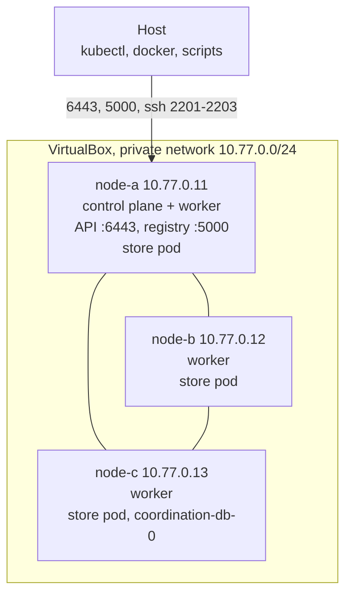
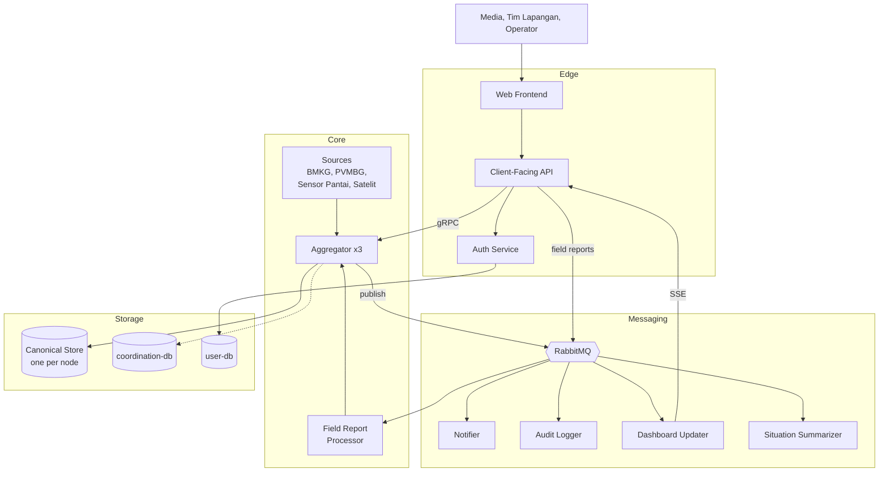

<div align="center">
   
</div>

<div align="center">


</div>

---

## About

Distributed Hazard Platform is the BNPB side of a disaster-information exchange. Two independent sources publish hazard data in different formats and with different authentication: **BMKG** (earthquakes and tsunami warnings, static API key) and **PVMBG** (volcanic reports, OAuth with a one-time code and rotating tokens). Both are mocks in this repository. BNPB polls them, maps everything into one canonical `HazardEvent`, serves it to Media, Tim Lapangan and Operator clients with per-role field access, and fans every new event out to independent consumers through RabbitMQ.

There are two ways to run it. Milestone 1 runs the whole stack with Docker Compose on one machine ([Quick start](#quick-start)). Milestone 2 runs it on a three node k3s cluster, with a sharded and replicated store, three Aggregator replicas that share polling through leases kept in `coordination-db`, a HorizontalPodAutoscaler, a third source (Sensor Pantai), an Audit API and the assistants' Tester Agent ([Kubernetes](#kubernetes-milestone-2)). The M2 picture is in [doc/ARCHITECTURE.md](doc/ARCHITECTURE.md). The diagrams and per-problem sections below describe the Compose stack.

## Kubernetes architecture

The Milestone 2 system runs on a three node k3s cluster. The VMs are VirtualBox guests on one host. The host reaches the cluster through forwarded ports, the nodes talk to each other on a private network.



| Namespace | What runs there |
|:---|:---|
| `sistem-informasi-kebencanaan-bnpb` | The whole system |
| `tester-agent` | The Tester Agent of the assistants, one pod per node, used to break things |
| `registry`, `kube-system` | The image registry and k3s itself |

| Kind | Workloads | Why this kind |
|:---|:---|:---|
| Deployment | `aggregator` (3 to 5 replicas by HPA), `client-facing-api`, `auth-service`, `notifier`, `audit-logger`, `dashboard-updater`, `field-report-processor` (2), `situation-summarizer`, `web-frontend`, `bmkg-mock`, `pvmbg-mock`, `sensor-pantai`, `prometheus`, `grafana`, `jaeger`, `kube-state-metrics` | Stateless, can be replaced or scaled at any time |
| StatefulSet | `coordination-db`, `user-db`, `rabbitmq` | A fixed name and a disk that stays with the pod |
| DaemonSet | `store` (updateStrategy `OnDelete`) | Exactly one Canonical Store database per node, so the data is spread over all three |

| How to reach it | Address |
|:---|:---|
| Web frontend | NodePort 30080 on any node |
| Client-Facing API | NodePort 30081 on any node |
| Grafana, Jaeger | `kubectl port-forward`, see [OBSERVABILITY.md](docs/OBSERVABILITY.md) |
| Everything else | Only inside the cluster, with NetworkPolicies that allow only the owner to reach a database |

Details: [TOPOLOGY.md](doc/TOPOLOGY.md) (nodes, ports, building and destroying the cluster), [DEPLOY.md](docs/DEPLOY.md) (what to apply and in which order), [ARCHITECTURE.md](doc/ARCHITECTURE.md) (how data moves).

## Service architecture



| Service | Does | Owns |
|:---|:---|:---|
| `aggregator` | Polls the sources, circuit breaker, maps records, writes to the shards, publishes events, serves reads over gRPC, Audit API | Canonical Store, `coordination-db` |
| `client-facing-api` | The only public API: JWT cookies, rate limit, load shedding, field projection per role | none |
| `auth-service` | Login, refresh, accounts | `user-db` |
| `field-report-processor` | Stores field reports idempotently after the broker has confirmed them | none |
| `notifier`, `audit-logger`, `dashboard-updater` | Independent consumers of `hazard.events`, each with its own queue and dedup | their own file |
| `situation-summarizer` | Bonus: summary of recent events, AI never on the alert path | none |
| `web-frontend` | SvelteKit static app behind nginx | none |
| `bmkg-mock`, `pvmbg-mock`, `sensor-pantai` | The sources. The first two are our mocks, the last is the assistants' image | none |

## What it solves

| Problem | Decision in the architecture | Where | Test | More |
|:---|:---|:---|:---|:---|
| Data on one node is lost with that node | 16 shards, 2 copies each, rebalance and repair loops, Audit API with checksum | `aggregator`, `store` | `problem1-k8s.sh`, `audit-checksum.sh` | [P1_STORAGE_DESIGN.md](doc/P1_STORAGE_DESIGN.md) |
| One replica or one source breaks the rest | Lease per source in `coordination-db`, fencing epoch, circuit breaker, HPA 3 to 5 | `aggregator` | `problem2-k8s.sh`, `autoscale.sh`, load scripts | [P2_LEASE_DESIGN.md](doc/P2_LEASE_DESIGN.md), [P2_FREEZE_TEST.md](doc/P2_FREEZE_TEST.md) |
| A bad or changed message must not be lost or crash a service | Guard before mapping, failed messages kept whole in `coordination-db`, replay, 202 only after the broker confirms field reports | `aggregator`, `client-facing-api` | `problem3-k8s.sh` | [P3_SCHEMA_POLICY.md](doc/P3_SCHEMA_POLICY.md) |
| A feed with late and corrected records | Event time, ordered micro-batches, versioned upsert, offset kept in `coordination-db` | `aggregator` | `tests/p4/` | [P4_FEED_NOTES.md](doc/P4_FEED_NOTES.md) |
| A sensor that cannot be trusted | Contract validation, separate path for critical alerts, load shedding that keeps Tim Lapangan | `aggregator`, `notifier` | `gameday.sh`, `critical-alerts.sh` | [P5_SLO.md](doc/P5_SLO.md), [postmortems](doc/postmortems/) |
| Bonus: nothing on the alert path waits for an AI | Separate consumer and queue, rule based fallback | `situation-summarizer` | `tests/bonus/ai-isolation.sh` | `tests/bonus/` |

The five Milestone 1 problems (schema change, a failing source, roles, service independence, fan-out) and their diagrams are in [PROBLEMS_M1.md](docs/PROBLEMS_M1.md).

## Deploy and test on Kubernetes

Follow these steps from a fresh clone. The cluster scripts need VirtualBox, `kubectl`, `ssh`, `curl`, `mkfs.vfat` and `mcopy` on the machine that hosts the VMs, and Docker to build the images. About 30 GB of disk and 7 GiB of free RAM are needed with the default sizes. Details are in [doc/TOPOLOGY.md](doc/TOPOLOGY.md) and [docs/DEPLOY.md](docs/DEPLOY.md).

```bash
git clone https://github.com/brii26/distributed-hazard-coordination.git
cd distributed-hazard-coordination

# 1. Cluster: 3 VMs (node-a control plane, node-b and node-c workers) and k3s
deploy/cluster/up.sh
deploy/cluster/k3s.sh
export KUBECONFIG=$HOME/vms/k3s/kubeconfig
kubectl get nodes

# 2. Images: build the eleven service images and push them to the registry on node-a
for s in aggregator bmkg-mock pvmbg-mock auth-service client-facing-api web-frontend dashboard-updater notifier audit-logger field-report-processor situation-summarizer; do
  docker build -t 127.0.0.1:5000/$s:0.1.0 services/$s
  docker push 127.0.0.1:5000/$s:0.1.0
done

# 3. Configuration: copy the example and replace every change-me value
cp .env.example .env

# 4. Tester Agent, installed once from the commit pinned by the spec (namespace tester-agent)
kubectl apply -f https://raw.githubusercontent.com/susTuna/if4031-tester-agent/ebb55261711123a9a211739ffbf140a275caa6da/manifest.yaml

# 5. One command deploy: Secrets, ConfigMaps, manifests, waits for every rollout, then runs the check
deploy/deploy.sh
```

`deploy/deploy.sh` ends with `deploy/check.sh`, which lists every pod with its `role` label and memory request and limit and exits 1 when one is wrong. `deploy/check.sh -k` does the same on the rendered manifests without a cluster.

**Topology declaration.** The number of nodes, their kind, the physical host of each and the CPU and RAM of each host depend on the machine that runs the cluster. Generate them on that machine, they are read only:

```bash
deploy/cluster/topology.sh
```

The defaults are 3 VirtualBox VMs with 2 vCPU and 2 GiB each on one host, node names `node-a`, `node-b` and `node-c`, addresses `10.77.0.11` to `10.77.0.13`.

**Configuration variables.** Every variable is in `.env.example` and described in [docs/CONFIGURATION.md](docs/CONFIGURATION.md). `deploy/make-secrets.sh` turns the secret ones into Kubernetes Secrets and `kubectl apply -k deploy/` creates the ConfigMap `bnpb-config` with the rest. The Secrets and ConfigMaps are listed in [docs/DEPLOY.md](docs/DEPLOY.md).

| Port | What |
|---|---|
| NodePort 30080 on any node, for example <http://10.77.0.11:30080> | Web frontend (it proxies `/api`). `COOKIE_SECURE` is `true`, so over plain HTTP on a node address use `kubectl -n sistem-informasi-kebencanaan-bnpb port-forward svc/web-frontend 3000:80` and open <http://localhost:3000> |
| NodePort 30081 on any node | Client-Facing API |
| `svc/grafana` 3000, `svc/jaeger` 16686 | Reach them with `kubectl -n sistem-informasi-kebencanaan-bnpb port-forward`, see [docs/OBSERVABILITY.md](docs/OBSERVABILITY.md) |

### Triggering the Kubernetes scenarios

Run them from the host with `KUBECONFIG` set. Which variables each script needs is in its header comment.

| Scenario | Command | Needs |
|---|---|---|
| Tester Agent, one failure | `kubectl exec -n tester-agent daemonset/tester-agent -- /app run practice <name>`, with `<name>` one of `kill-leader`, `kill-store`, `wipe-node`, `partition`, `clock-skew`, `schema` (`/app list` prints them) | The result is in `kubectl logs -n tester-agent -l app=tester-agent`, see [doc/TESTER_AGENT_NOTES.md](doc/TESTER_AGENT_NOTES.md) |
| Game day, a mix of the above, a PVMBG outage and a load spike | `tests/scenarios/gameday.sh` (`DRY_RUN=1` prints the plan only) | Three accounts, see the script header |
| Problem 1 end to end: a node loses all its data and returns empty, the next node is lost | `tests/scenarios/problem1-k8s.sh` (`ONLY="A B"`, `DRY_RUN=1`) | It stops the store on one node and empties its hostPath, then restores the DaemonSet, so use a cluster nobody else uses. FAIL means the implementation is wrong. Manual node join: [doc/P1_TEST_NOTES.md](doc/P1_TEST_NOTES.md) |
| Problem 3 end to end: schema changes, failed messages, replay, field reports | `tests/scenarios/problem3-k8s.sh` (`ONLY="1 2"` picks scenarios, `DRY_RUN=1` prints the plan only) | The Tester Agent for scenario 3. It breaks the PVMBG mock, stops the field report processor and patches `bnpb-config`, then restores them, so use a cluster nobody else uses. FAIL means the implementation is wrong, NOT RUN means the script could not run. See the script header |
| Rolling update under load | `EMAIL=... PASSWORD=... tests/scenarios/rolling-update.sh` | k6 or Docker |
| Autoscaling | `API_URL=http://10.77.0.11:30081 AUDIT_TOKEN=... tests/scenarios/autoscale.sh` | k6 or Docker, a Tim Lapangan account |
| Audit checksum | `AUDIT_URL=... AUDIT_TOKEN=... tests/scenarios/audit-checksum.sh [BMKG\|PVMBG]` | The Audit API on an Aggregator |
| Trace and log correlation | `TARGET=k8s tests/scenarios/trace-check.sh` | Port-forwards for the API (8080) and Jaeger (16686) |
| Problem 2 load test, 10k VUs | `tests/load/p2-k8s.sh`, `tests/load/p2-ratio.sh` | See [tests/load/README.md](tests/load/README.md) |
| Priority load shedding | `tests/load/priority.sh` | Go, Docker and Python 3, see [docs/TESTING.md](docs/TESTING.md) |

Several of these scripts have been checked offline only. The status of each is stated in [docs/DEPLOY.md](docs/DEPLOY.md) and [tests/load/README.md](tests/load/README.md).

## Quick start

This is the Milestone 1 stack on one machine with Docker Compose, no Kubernetes. It needs Docker Compose. Full prerequisites and details are in [docs/RUNNING.md](docs/RUNNING.md).

```bash
git clone https://github.com/brii26/distributed-hazard-coordination.git
cd distributed-hazard-coordination
cp .env.example .env
docker compose up -d --build --wait
```

| Port | What |
|---|---|
| <http://localhost:3000> | Web frontend (log in as `SEED_OPERATOR_EMAIL` / `SEED_OPERATOR_PASSWORD` from `.env`) |
| <http://localhost:8080> | Client-Facing API, the only public API |
| <http://localhost:8081> | BMKG mock (needs `X-BMKG-Key`) |
| <http://localhost:8082> | PVMBG mock, including the demo switches `/admin/outage`, `/admin/schema-version` and `/admin/malformed` |
| <http://localhost:15672> | RabbitMQ management UI |

Stop it with `docker compose down` (add `-v` to wipe the data).

## Documentation

| Document | Contents |
|:---|:---|
| [docs/PROBLEMS_M1.md](docs/PROBLEMS_M1.md) | The five Milestone 1 problems with their diagrams |
| [docs/RUNNING.md](docs/RUNNING.md) | Prerequisites, running from a clean clone, repository layout, single service, web frontend |
| [docs/DEPLOY.md](docs/DEPLOY.md) | The namespace, ConfigMaps, Secrets, the order to apply them, autoscaling, rolling update, `check.sh` |
| [doc/TOPOLOGY.md](doc/TOPOLOGY.md) | The k3s cluster: nodes, ports, registry, how to build and destroy it |
| [doc/ARCHITECTURE.md](doc/ARCHITECTURE.md) | How data moves on k3s and where each part is defined |
| [docs/OBSERVABILITY.md](docs/OBSERVABILITY.md) | Metrics, traces, the Grafana dashboard and the SLO rules |
| [docs/CONFIGURATION.md](docs/CONFIGURATION.md) | The `.env` file and every variable |
| [docs/TEST_SCENARIOS.md](docs/TEST_SCENARIOS.md) | Walkthroughs for Problems 1 to 5 |
| [docs/TESTING.md](docs/TESTING.md) | Integration, smoke, load and storage tests, pre-push checks |
| [doc/TESTER_AGENT_NOTES.md](doc/TESTER_AGENT_NOTES.md) | What each Tester Agent scenario did on our cluster |
| [CONTRIBUTING.md](CONTRIBUTING.md) | Workflow and conventions |

## Authors

<div align="center">

| NIM | Name | Contribution |
|:---:|:---|:---|
| 13523097 | Shanice Feodora Tjahjono | - Message broker, pub/sub fanout<br>- Producer buffer and confirms<br>- Three consumers with dedup<br>- SSE live updates<br>- Problems 4 and 5 |
| 13523126 | Brian Ricardo Tamin | - Aggregator: pollers, circuit breaker, gRPC read API<br>- PVMBG token rotation<br>- Rate limit and concurrency cap<br>- Per-field authorization<br>- Logs, health checks, tests, README<br>- Problem 2 |
| 13523142 | Nathanael Rachmat | - Auth Service, JWT, transparent refresh<br>- Source credentials on the mocks<br>- Schema-change switch, `attributes` mapping<br>- Canonical Store schema<br>- Tracing, web frontend<br>- Load and smoke tests<br>- Problems 1 and 3 |

</div>

---

<div align="center">
   
</div>
