<div align="center">
   
</div>

<div align="center">


</div>

---

## About

Distributed Hazard Platform is the BNPB side of a disaster-information exchange. Two independent sources publish hazard data in different formats and with different authentication: **BMKG** (earthquakes and tsunami warnings, static API key) and **PVMBG** (volcanic reports, OAuth with a one-time code and rotating tokens). Both are mocks in this repository. BNPB polls them, maps everything into one canonical `HazardEvent`, serves it to Media, Tim Lapangan and Operator clients with per-role field access, and fans every new event out to independent consumers through RabbitMQ.

There are two ways to run it. Milestone 1 runs the whole stack with Docker Compose on one machine ([Quick start](#quick-start)). Milestone 2 runs it on a three node k3s cluster, with a sharded and replicated store, three Aggregator replicas that share polling through leases kept in `coordination-db`, a HorizontalPodAutoscaler, a third source (Sensor Pantai), an Audit API and the assistants' Tester Agent ([Kubernetes](#kubernetes-milestone-2)). The M2 picture is in [doc/ARCHITECTURE.md](doc/ARCHITECTURE.md). The diagrams and per-problem sections below describe the Compose stack.

## Architecture

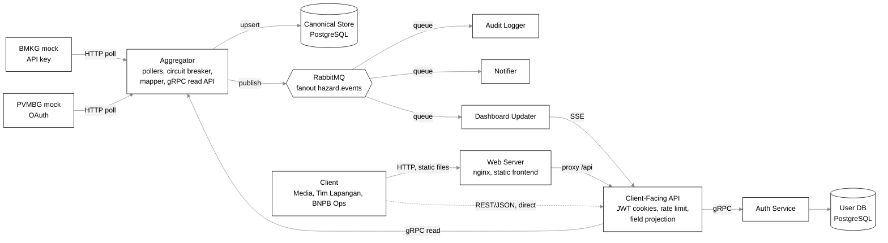

Every box except the client is its own container. The nginx container serves the static frontend and proxies `/api/*` to the Client-Facing API, which keeps the page and the API on one origin; the API can also be called directly on its own port. Each database is reachable only by its owner (`canonical-store` by the Aggregator, `user-db` by the Auth Service). The Client-Facing API is the only public API and the only place a JWT is verified. Jaeger and Prometheus sit beside the stack for traces and metrics.

| Service | Role |
|:---|:---|
| `bmkg-mock`, `pvmbg-mock` | The two external sources, with injected latency, an outage switch and a schema switch |
| `aggregator` | One poller per source, circuit breaker, mapping to `HazardEvent`, upsert to the Canonical Store, event publishing, gRPC read API |
| `canonical-store` | PostgreSQL with a JSONB `attributes` column, so unknown source fields need no migration |
| `auth-service`, `user-db` | Login, refresh, logout, registration, accounts; salted password hashes |
| `client-facing-api` | Public REST API, JWT in HttpOnly cookies, transparent refresh, token-bucket rate limit, global concurrency cap, per-role field projection |
| `rabbitmq` | Fanout exchange `hazard.events`, one durable queue per consumer |
| `dashboard-updater`, `notifier`, `audit-logger` | Independent consumers, each with its own dedup store |
| `situation-summarizer` | Bonus consumer with its own queue: periodic summary of recent events, LLM or rule based, read through `GET /situation` |
| `web-frontend` | SvelteKit static app served by nginx, which also proxies `/api/*` |
| `jaeger`, `prometheus` | Traces (the trace ID is the `correlation_id` in logs) and request metrics |
| `grafana` (k8s only) | One dashboard of all services. `kubectl port-forward svc/grafana 3000`, then http://localhost:3000, login `admin`, password from `deploy/make-secrets.sh` (see [OBSERVABILITY.md](docs/OBSERVABILITY.md)) |

## Tech stack

| Layer | Technology |
|:---|:---|
| Services | Go, one module per service, tied by `go.work` |
| Service-to-service | gRPC from the Client-Facing API to the Aggregator and the Auth Service, AMQP through RabbitMQ |
| Public API | REST over HTTP, JWT HS256 in HttpOnly cookies |
| Storage | PostgreSQL (Canonical Store, User DB) |
| Broker | RabbitMQ, fanout exchange, durable queues, publisher confirms |
| Live updates | Server-Sent Events from the Dashboard Updater through the Client-Facing API |
| Frontend | SvelteKit (`adapter-static`) served by nginx |
| Observability | OpenTelemetry, Jaeger, Prometheus, structured JSON logs with a correlation ID |
| Orchestration | Docker Compose (M1), k3s on three VirtualBox VMs (M2) |
| Tests | Go tests, shell scenario scripts, k6 load test, Tester Agent scenarios (M2) |

## What it solves

Each problem is solved in the code and reproduced by a script in `tests/scenarios/`. The steps are under [Test scenarios](#test-scenarios-problems-1-to-5).

### Problem 1: the source changes its schema and nothing restarts

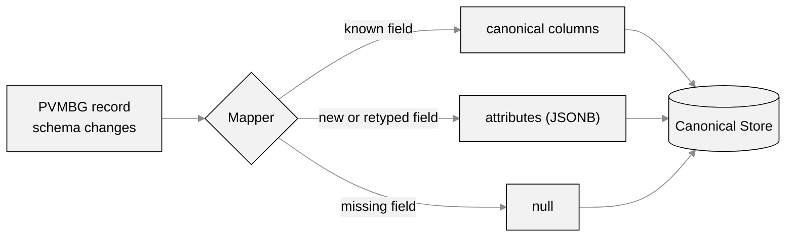

- Unknown fields go to a JSONB `attributes` column, so the table never needs a migration and the Aggregator never restarts.
- Old rows stay as they were. A field that changes meaning, or a moved endpoint, is a documented limit.

Problem 3 schema policy: a PVMBG record must carry all six contract fields with their contract types. A record that misses one, sends `null`, or changes a type is rejected with a `schema_incompatible: ...` reason instead of being stored with nulls. New fields still go to `attributes`, and BMKG keeps the tolerant policy above. See [doc/P3_SCHEMA_POLICY.md](doc/P3_SCHEMA_POLICY.md).

---

### Problem 2: a slow or failing source must not drag the others down

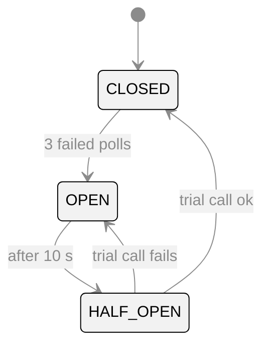

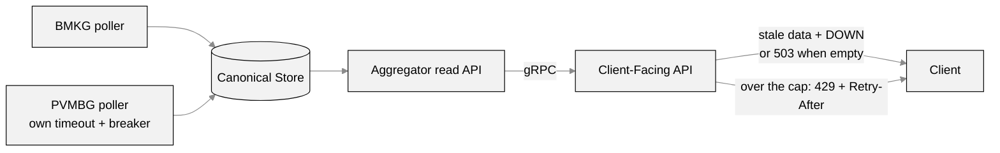

- One poller, timeout and circuit breaker per source. Reads come from the store, so an outage costs freshness and not availability.
- Overload is shed on purpose: a global concurrency cap, a token bucket per account, and a cap on the gRPC read API.

---

### Problem 3: authentication and per-field access

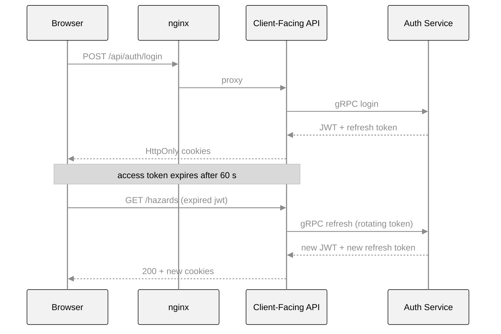

| Role | Fields | Accounts |
|:---|:---|:---|
| Media | summary only, 403 on raw fields | none |
| Tim Lapangan | all | none |
| Operator | all | can create |

- BMKG takes a static key. PVMBG uses OAuth with a one-time code and rotating opaque tokens that the Aggregator renews by itself.
- Only the Client-Facing API verifies the JWT.

---

### Problem 4: independent services and storage ownership

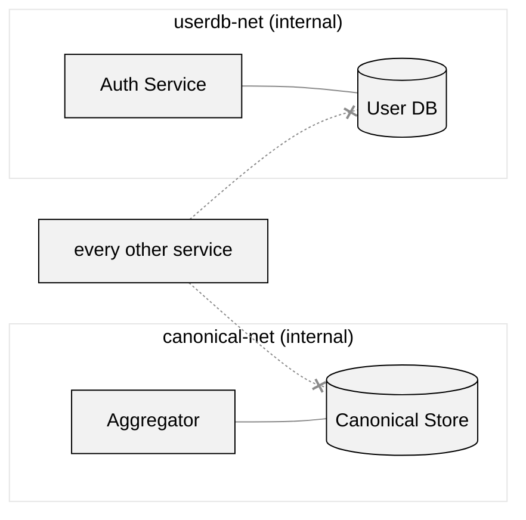

- Every component is its own container and image, with a `/health` that reports depth. One can be stopped, rebuilt and restarted while the rest keep running.
- Each database is reachable only by its owner and publishes no host port.

---

### Problem 5: event fan-out to independent consumers

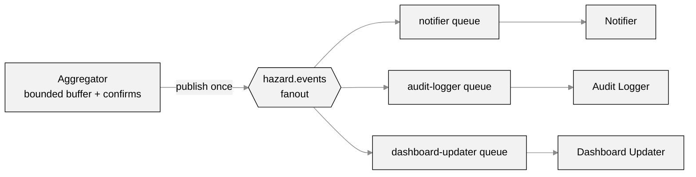

- One publish reaches every consumer through its own durable queue. A stopped consumer's queue keeps the backlog and it catches up on return, while the others carry on.
- Consumers acknowledge after processing (at-least-once), so each one deduplicates. A new consumer only declares a queue on the exchange, with no change to the producer.

## Screenshots

Taken from a local `docker compose up` with the example `.env`.

<div align="center">

**Login**

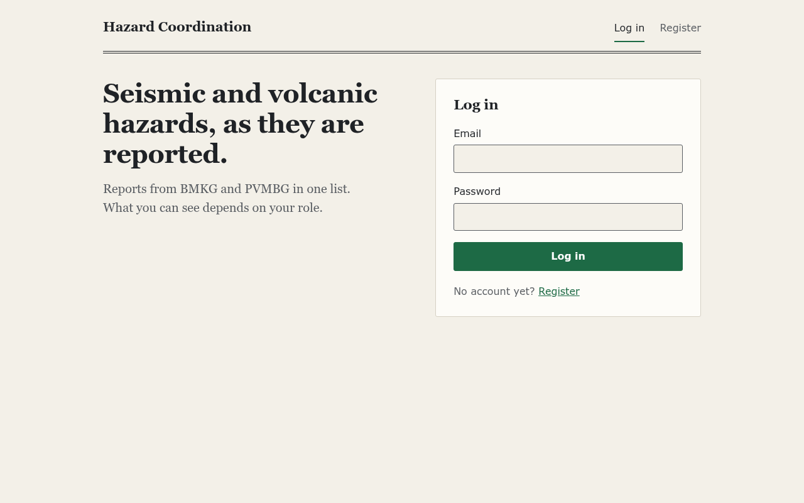

Log in with the seeded Operator, or with an account created through Register.

<br/>

**Hazards, Seismic tab (BMKG)**

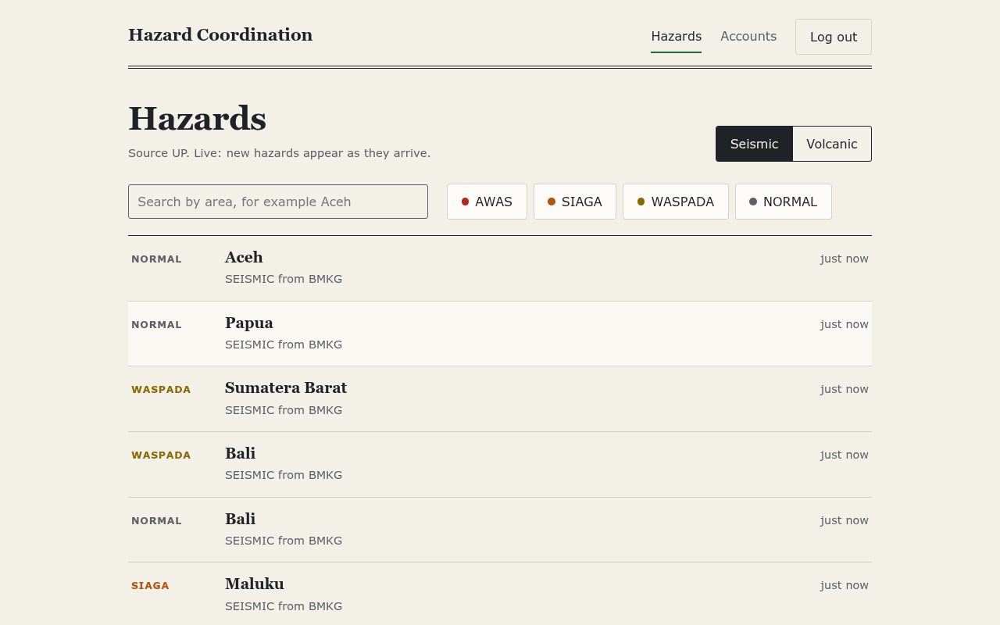

Live list from the Client-Facing API with a severity filter and search.

<br/>

**Hazards, Volcanic tab (PVMBG)**

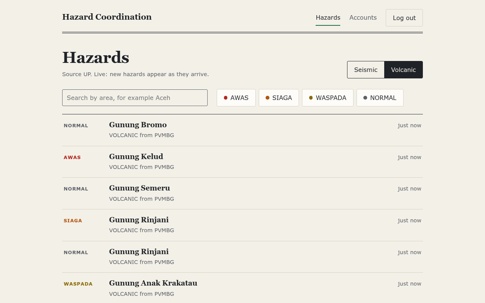

The same list for PVMBG reports.

<br/>

**Create an account (Operator only)**

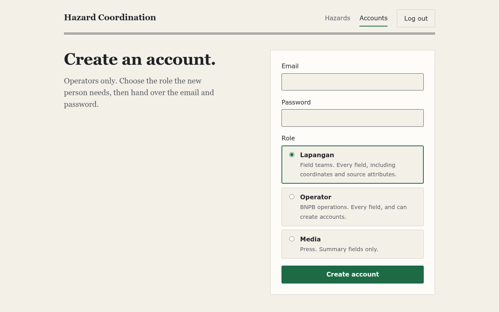

The chosen role decides which fields the API returns.

<br/>

**RabbitMQ queues**

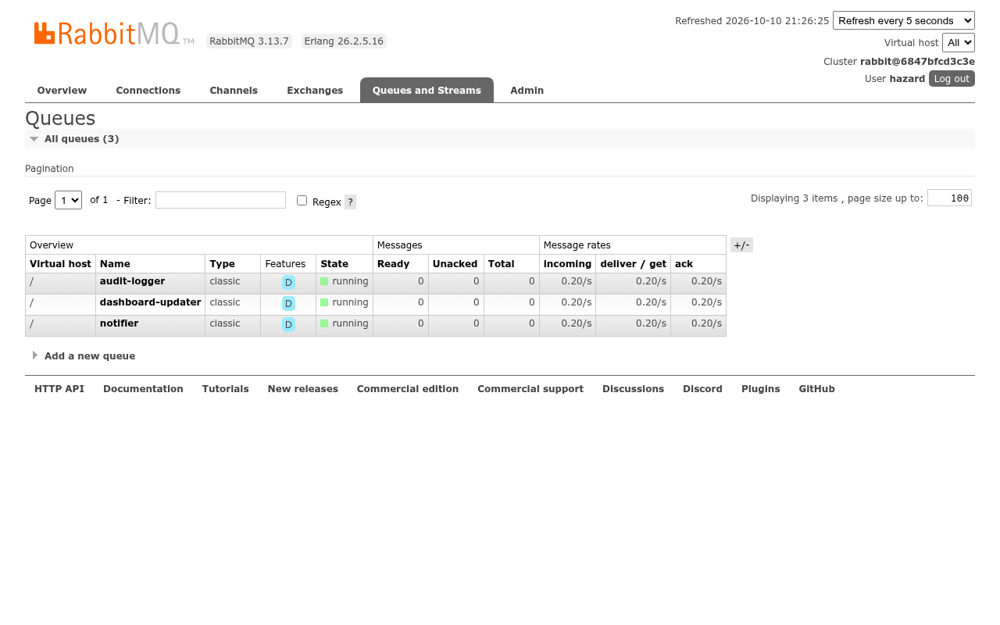

One durable queue per consumer.

<br/>

**Jaeger, recent traces**

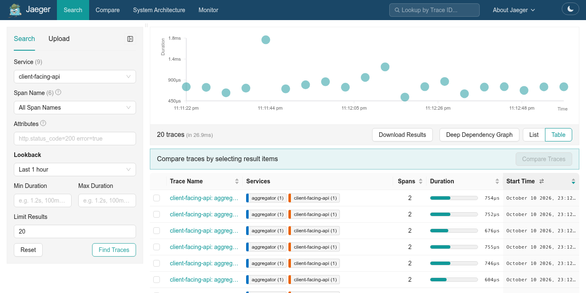

Latest Client-Facing API traces.

<br/>

**One GET /hazards end to end**

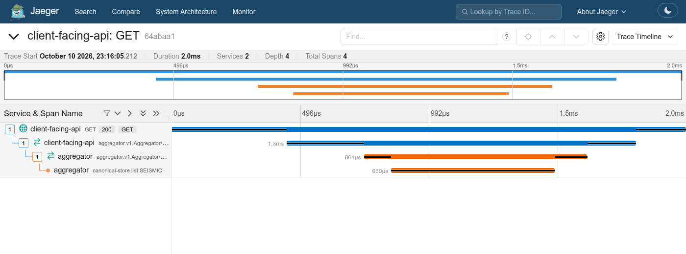

Client-Facing API, then the Aggregator over gRPC, then the Canonical Store query.

<br/>

**Jaeger Monitor**

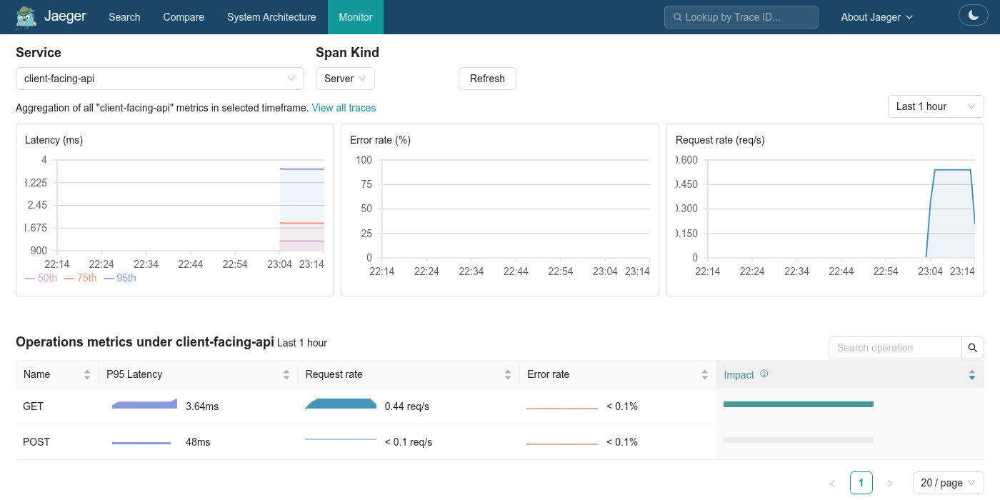

Latency, errors and request rate, read from Prometheus.

</div>

## Kubernetes (Milestone 2)

Follow these steps from a fresh clone. The cluster scripts need VirtualBox, `kubectl`, `ssh`, `curl`, `mkfs.vfat` and `mcopy` on the machine that hosts the VMs, and Docker to build the images. About 30 GB of disk and 7 GiB of free RAM are needed with the default sizes. Details are in [doc/TOPOLOGY.md](doc/TOPOLOGY.md) and [docs/DEPLOY.md](docs/DEPLOY.md).

```bash
git clone https://github.com/brii26/distributed-hazard-coordination.git
cd distributed-hazard-coordination

# 1. Cluster: 3 VMs (node-a control plane, node-b and node-c workers) and k3s
deploy/cluster/up.sh
deploy/cluster/k3s.sh
export KUBECONFIG=$HOME/vms/k3s/kubeconfig
kubectl get nodes

# 2. Images: build the nine service images and push them to the registry on node-a
for s in aggregator bmkg-mock pvmbg-mock auth-service client-facing-api web-frontend dashboard-updater notifier audit-logger; do
  docker build -t 127.0.0.1:5000/$s:0.1.0 services/$s
  docker push 127.0.0.1:5000/$s:0.1.0
done

# 3. Configuration: copy the example and replace every change-me value
cp .env.example .env

# 4. Tester Agent, installed once from the commit pinned by the spec (namespace tester-agent)
kubectl apply -f https://raw.githubusercontent.com/susTuna/if4031-tester-agent/ebb55261711123a9a211739ffbf140a275caa6da/manifest.yaml

# 5. One command deploy: Secrets, ConfigMaps, manifests, waits for every rollout, then runs the check
deploy/deploy.sh
```

`deploy/deploy.sh` ends with `deploy/check.sh`, which lists every pod with its `role` label and memory request and limit and exits 1 when one is wrong. `deploy/check.sh -k` does the same on the rendered manifests without a cluster.

**Topology declaration.** The number of nodes, their kind, the physical host of each and the CPU and RAM of each host depend on the machine that runs the cluster. Generate them on that machine, they are read only:

```bash
deploy/cluster/topology.sh
```

The defaults are 3 VirtualBox VMs with 2 vCPU and 2 GiB each on one host, node names `node-a`, `node-b` and `node-c`, addresses `10.77.0.11` to `10.77.0.13`.

**Configuration variables.** Every variable is in `.env.example` and described in [docs/CONFIGURATION.md](docs/CONFIGURATION.md). `deploy/make-secrets.sh` turns the secret ones into Kubernetes Secrets and `kubectl apply -k deploy/` creates the ConfigMap `bnpb-config` with the rest. The Secrets and ConfigMaps are listed in [docs/DEPLOY.md](docs/DEPLOY.md).

| Port | What |
|---|---|
| NodePort 30080 on any node, for example <http://10.77.0.11:30080> | Web frontend (it proxies `/api`). `COOKIE_SECURE` is `true`, so over plain HTTP on a node address use `kubectl -n sistem-informasi-kebencanaan-bnpb port-forward svc/web-frontend 3000:80` and open <http://localhost:3000> |
| NodePort 30081 on any node | Client-Facing API |
| `svc/grafana` 3000, `svc/jaeger` 16686 | Reach them with `kubectl -n sistem-informasi-kebencanaan-bnpb port-forward`, see [docs/OBSERVABILITY.md](docs/OBSERVABILITY.md) |

### Triggering the Kubernetes scenarios

Run them from the host with `KUBECONFIG` set. Which variables each script needs is in its header comment.

| Scenario | Command | Needs |
|---|---|---|
| Tester Agent, one failure | `kubectl exec -n tester-agent daemonset/tester-agent -- /app run practice <name>`, with `<name>` one of `kill-leader`, `kill-store`, `wipe-node`, `partition`, `clock-skew`, `schema` (`/app list` prints them) | The result is in `kubectl logs -n tester-agent -l app=tester-agent`, see [doc/TESTER_AGENT_NOTES.md](doc/TESTER_AGENT_NOTES.md) |
| Game day, a mix of the above, a PVMBG outage and a load spike | `tests/scenarios/gameday.sh` (`DRY_RUN=1` prints the plan only) | Three accounts, see the script header |
| Rolling update under load | `EMAIL=... PASSWORD=... tests/scenarios/rolling-update.sh` | k6 or Docker |
| Autoscaling | `API_URL=http://10.77.0.11:30081 AUDIT_TOKEN=... tests/scenarios/autoscale.sh` | k6 or Docker, a Tim Lapangan account |
| Audit checksum | `AUDIT_URL=... AUDIT_TOKEN=... tests/scenarios/audit-checksum.sh [BMKG\|PVMBG]` | The Audit API on an Aggregator |
| Trace and log correlation | `TARGET=k8s tests/scenarios/trace-check.sh` | Port-forwards for the API (8080) and Jaeger (16686) |
| Problem 2 load test, 10k VUs | `tests/load/p2-k8s.sh`, `tests/load/p2-ratio.sh` | See [tests/load/README.md](tests/load/README.md) |
| Priority load shedding | `tests/load/priority.sh` | Go, Docker and Python 3, see [docs/TESTING.md](docs/TESTING.md) |

Several of these scripts have been checked offline only. The status of each is stated in [docs/DEPLOY.md](docs/DEPLOY.md) and [tests/load/README.md](tests/load/README.md).

## Quick start

This is the Milestone 1 stack on one machine with Docker Compose, no Kubernetes. It needs Docker Compose. Full prerequisites and details are in [docs/RUNNING.md](docs/RUNNING.md).

```bash
git clone https://github.com/brii26/distributed-hazard-coordination.git
cd distributed-hazard-coordination
cp .env.example .env
docker compose up -d --build --wait
```

| Port | What |
|---|---|
| <http://localhost:3000> | Web frontend (log in as `SEED_OPERATOR_EMAIL` / `SEED_OPERATOR_PASSWORD` from `.env`) |
| <http://localhost:8080> | Client-Facing API, the only public API |
| <http://localhost:8081> | BMKG mock (needs `X-BMKG-Key`) |
| <http://localhost:8082> | PVMBG mock, including the demo switches `/admin/outage` and `/admin/schema-version` |
| <http://localhost:15672> | RabbitMQ management UI |

Stop it with `docker compose down` (add `-v` to wipe the data).

## Documentation

| Document | Contents |
|---|---|
| [docs/RUNNING.md](docs/RUNNING.md) | Prerequisites, running from a clean clone, repository layout, database isolation check, single service, web frontend |
| [docs/DEPLOY.md](docs/DEPLOY.md) | Kubernetes: the namespace, ConfigMaps, Secrets, the order to apply them, autoscaling, rolling update, the one command deploy and `check.sh` |
| [doc/TOPOLOGY.md](doc/TOPOLOGY.md) | The k3s cluster: nodes, ports, registry, how to build and destroy it |
| [doc/ARCHITECTURE.md](doc/ARCHITECTURE.md) | The M2 architecture on k3s and where each part is defined |
| [docs/OBSERVABILITY.md](docs/OBSERVABILITY.md) | Metrics, traces, the Grafana dashboard and the SLO rules |
| [doc/TESTER_AGENT_NOTES.md](doc/TESTER_AGENT_NOTES.md) | What each Tester Agent scenario did on our cluster |
| [docs/CONFIGURATION.md](docs/CONFIGURATION.md) | The `.env` file and every variable |
| [docs/TEST_SCENARIOS.md](docs/TEST_SCENARIOS.md) | Copy-paste walkthroughs for Problems 1 to 5 |
| [docs/TESTING.md](docs/TESTING.md) | Integration, smoke, load and storage tests, pre-push checks |
| [CONTRIBUTING.md](CONTRIBUTING.md) | Workflow and conventions |


## Authors

<div align="center">

| NIM | Name | Contribution |
|:---:|:---|:---|
| 13523097 | Shanice Feodora Tjahjono | - Message broker, pub/sub fanout<br>- Producer buffer and confirms<br>- Three consumers with dedup<br>- SSE live updates<br>- Problems 4 and 5 |
| 13523126 | Brian Ricardo Tamin | - Aggregator: pollers, circuit breaker, gRPC read API<br>- PVMBG token rotation<br>- Rate limit and concurrency cap<br>- Per-field authorization<br>- Logs, health checks, tests, README<br>- Problem 2 |
| 13523142 | Nathanael Rachmat | - Auth Service, JWT, transparent refresh<br>- Source credentials on the mocks<br>- Schema-change switch, `attributes` mapping<br>- Canonical Store schema<br>- Tracing, web frontend<br>- Load and smoke tests<br>- Problems 1 and 3 |

</div>

---

<div align="center">
   
</div>
