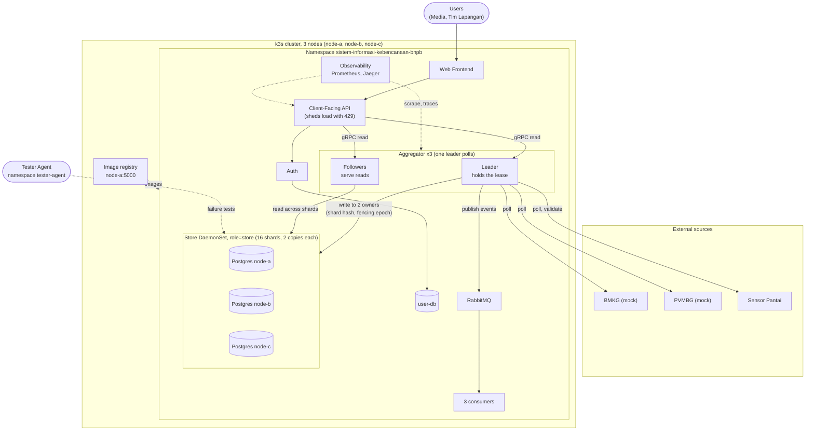

# Architecture

High level view of the system on Kubernetes. The cluster itself (nodes, ports, registry) is in [TOPOLOGY.md](TOPOLOGY.md), the deploy steps in [../docs/DEPLOY.md](../docs/DEPLOY.md).

## How data moves

- **In:** only the leader Aggregator polls BMKG, PVMBG and Sensor Pantai. Each record gets a `hazard_id` (UUID v5), is hashed to one of 16 shards, and is written to the two nodes that own that shard. New or changed records are published to RabbitMQ for the consumers.
- **Out:** a user reaches the Web Frontend, which calls the Client-Facing API. The API checks the caller through Auth and reads from the Aggregators over gRPC. Every Aggregator replica serves reads, merging the shards and marking the answer `partial` when a shard cannot be reached.
- **Failure handling:** the lease picks one poller and the fencing epoch makes the store refuse writes from an old leader ([P2_LEASE_DESIGN.md](P2_LEASE_DESIGN.md)). Two copies per shard keep reads working when one node is down ([P1_STORAGE_DESIGN.md](P1_STORAGE_DESIGN.md)). The Client-Facing API sheds load so Tim Lapangan keeps capacity when Media overloads it.

## What is in the cluster today

| Part | State |
|---|---|
| Namespace, ConfigMap, Secrets | Done (`deploy/`, #270) |
| Sharded store (DaemonSet) | Done |
| Observability | Done |
| Aggregator | Manifest in review (#272) |
| BMKG and PVMBG mocks | Not yet (#271) |
| Auth, user-db, Client-Facing API, Web Frontend | Not yet (#273) |
| RabbitMQ and the consumers | Not yet (#274) |
| Sensor Pantai poller | Not yet, the validator is in review (#319) |
| Lease and fencing | Lease in review (#283), fencing not yet (#284) |

Update this table when a part lands.
