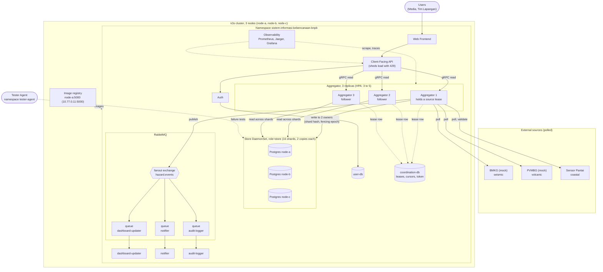

# Architecture

High level view of the system on Kubernetes. The cluster itself (nodes, ports, registry) is in [TOPOLOGY.md](TOPOLOGY.md), the deploy steps in [../docs/DEPLOY.md](../docs/DEPLOY.md).

## How data moves

- **In:** every replica runs the lease, but each source is polled only by the replica that holds that source's lease (the three sources may have different holders). The sources are BMKG (seismic), PVMBG (volcanic) and Sensor Pantai (coastal). Each record gets a `hazard_id` (UUID v5), is hashed to one of 16 shards, and is written to the two nodes that own that shard. New or changed records are published once to the fanout exchange `hazard.events`. Each consumer (`dashboard-updater`, `notifier`, `audit-logger`) has its own durable queue bound to it, so every consumer gets every event and the Aggregator does not know they exist.
- **Out:** a user reaches the Web Frontend, which calls the Client-Facing API. The API checks the caller through Auth and reads from the Aggregators over gRPC. All Aggregator replicas (3 to 5, the HorizontalPodAutoscaler decides) serve reads, merging the shards and marking the answer `partial` when a shard cannot be reached.
- **Failure handling:** the lease, stored in `coordination-db`, picks one poller per source and the fencing epoch makes the store refuse writes from an old leader ([P2_LEASE_DESIGN.md](P2_LEASE_DESIGN.md)). Two copies per shard keep reads working when one node is down ([P1_STORAGE_DESIGN.md](P1_STORAGE_DESIGN.md)). The Client-Facing API sheds load so Tim Lapangan keeps capacity when Media overloads it.

## What is in the cluster

| Part | Where it is defined |
|---|---|
| Namespace, ConfigMap `bnpb-config`, Secrets | `deploy/namespace.yaml`, `deploy/configmap.yaml`, `deploy/make-secrets.sh` |
| Sharded store (DaemonSet `store`, `role: store`) | `deploy/store.yaml`, schema from `deploy/make-schema.sh` |
| `coordination-db` (leases, cursors, PVMBG token pair) | `deploy/coordination-db.yaml`, `deploy/make-coordination.sh` |
| Aggregator (3 replicas) and its HPA (min 3, max 5, 60% CPU) | `deploy/aggregator.yaml`, `deploy/aggregator-hpa.yaml` |
| BMKG and PVMBG mocks | `deploy/bmkg-mock.yaml`, `deploy/pvmbg-mock.yaml` |
| Sensor Pantai | `deploy/sensor-pantai/` (`deploy/overlays/exam` for the exam profile) |
| Auth, user-db, Client-Facing API, Web Frontend | `deploy/auth-service.yaml`, `user-db.yaml`, `client-facing-api.yaml`, `web-frontend.yaml` |
| RabbitMQ and the three consumers | `deploy/rabbitmq.yaml`, `dashboard-updater.yaml`, `notifier.yaml`, `audit-logger.yaml` |
| NetworkPolicies for storage isolation | `deploy/networkpolicy.yaml` |
| Observability (Prometheus, Jaeger, Grafana, kube-state-metrics) | `deploy/observability/` |
| Tester Agent (namespace `tester-agent`, installed from the pinned upstream manifest) | [TESTER_AGENT_NOTES.md](TESTER_AGENT_NOTES.md) |

What was run on a real cluster and what was only checked offline is stated where each part is documented, for example in [DEPLOY.md](../docs/DEPLOY.md) and `tests/load/README.md`.
