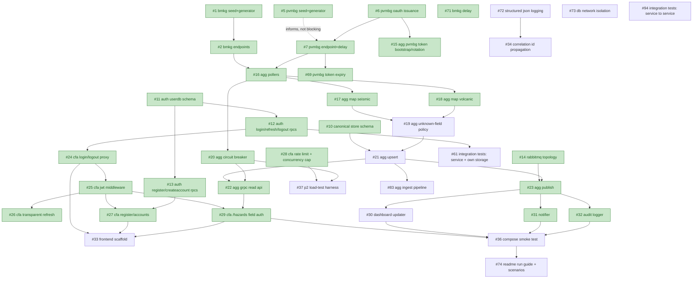

# Backlog Dependency Graph

Not a schedule — an Activity-on-Node map of the M1 backlog (GitHub issues #1–#37), so anyone can answer "what can I start right now?" without reading every issue's `blocked-by` field individually. Dependencies are set as native GitHub issue relationships (`gh issue edit --add-blocked-by`), visible on each issue itself; this doc is the whole-graph view GitHub doesn't render on its own.

Regenerate after adding/closing issues: `gh issue list --repo brii26/distributed-hazard-coordination --json number,title,state`.

## Ready now (no open blockers)

These have zero dependencies and can be picked up immediately, by anyone, in any order:

- #19 Aggregator: unknown/changed-field policy enforcement
- #30 Dashboard Updater: consume HazardEvent and maintain in-memory state
- #33 Web Frontend: CSR scaffold (login, register, hazards views)
- #35 Cross-cutting: health check depth per service
- #37 Cross-cutting: P2 load-test harness
- #61 Cross-cutting: integration tests for a service and its own database or broker
- #94 Cross-cutting: integration tests between our services (service to service)
- #72 Cross-cutting: structured JSON logging and outbound call latency for every service
- #73 Infra: Docker network isolation for Canonical Store and User DB

## Full graph

Green = merged. Merged issues stay in the graph (edges kept) so progress is visible; only the "Ready now" list drops them.

## Notes on reading this

- **BMKG/PVMBG cluster** (#1–#9) is almost entirely parallelizable — the mocks don't depend on each other or on anything downstream.
- **Aggregator** (#15–#23) is the critical path: nothing in Client-Facing API's real data flow (#29 onward) or the consumers (#30–#32) can start until the Aggregator chain reaches #21 (upsert) and #22/#23 (the two things it feeds).
- **Auth Service** (#11–#13) and **Client-Facing API's auth chain** (#24–#27) can run fully in parallel with the Aggregator chain — they don't share a blocker until #29, which needs *both* #25 (JWT middleware) and #22 (Aggregator's read API).
- **#28** (rate limiting), **#35** (health checks), **#71** (BMKG delay), **#72** (structured logging) and **#73** (network isolation) are deliberately unblocked: they touch one or every service but need no other issue to land first. Fold them into whichever issue you are already touching rather than leaving them for a separate pass at the end. **#34** (correlation IDs) waits only on #72, so it reuses that logger instead of adding its own.
- **#83** (ingest pipeline) is what connects the pollers, the mapper and the store. It waits only on #21, and publishing plugs into it later through #23, which is not a blocker.
- **#36/#37** are integration-level checks, by design the last things that can go green, since they need real pieces on both sides of the stack. **#74** (README run guide and scenario triggers) follows #36 because it documents the finished stack.
