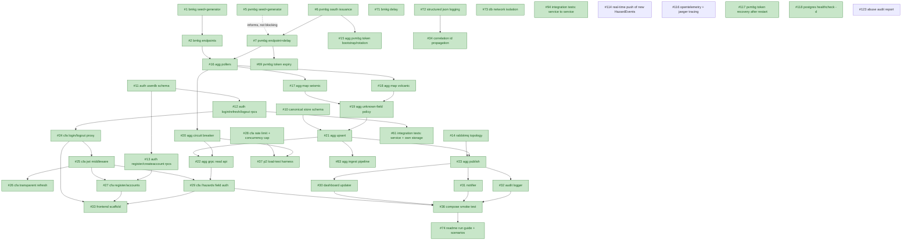

# Backlog Dependency Graph

Not a schedule — an Activity-on-Node map of the M1 backlog (GitHub issues #1–#37), so anyone can answer "what can I start right now?" without reading every issue's `blocked-by` field individually. Dependencies are set as native GitHub issue relationships (`gh issue edit --add-blocked-by`), visible on each issue itself; this doc is the whole-graph view GitHub doesn't render on its own.

Regenerate after adding/closing issues: `gh issue list --repo brii26/distributed-hazard-coordination --json number,title,state`.

## Ready now (no open blockers)

These have zero dependencies and can be picked up immediately, by anyone, in any order:

- #114 Real-time push of new HazardEvents to clients, no polling
- #116 Cross-cutting: OpenTelemetry tracing with Jaeger across all services
- #123 Audit report: failures found by the abuse test script

## Full graph

Green = merged. Merged issues stay in the graph (edges kept) so progress is visible; only the "Ready now" list drops them.

## Notes on reading this

- **BMKG/PVMBG cluster** (#1–#9) is almost entirely parallelizable — the mocks don't depend on each other or on anything downstream.
- **Aggregator** (#15–#23) is the critical path: nothing in Client-Facing API's real data flow (#29 onward) or the consumers (#30–#32) can start until the Aggregator chain reaches #21 (upsert) and #22/#23 (the two things it feeds).
- **Auth Service** (#11–#13) and **Client-Facing API's auth chain** (#24–#27) can run fully in parallel with the Aggregator chain — they don't share a blocker until #29, which needs *both* #25 (JWT middleware) and #22 (Aggregator's read API).
- **#28** (rate limiting), **#35** (health checks), **#71** (BMKG delay), **#72** (structured logging) and **#73** (network isolation) are deliberately unblocked: they touch one or every service but need no other issue to land first. Fold them into whichever issue you are already touching rather than leaving them for a separate pass at the end. **#34** (correlation IDs) waits only on #72, so it reuses that logger instead of adding its own.
- **#83** (ingest pipeline) is what connects the pollers, the mapper and the store. It waits only on #21, and publishing plugs into it later through #23, which is not a blocker.
- **#36/#37** are integration-level checks, by design the last things that can go green, since they need real pieces on both sides of the stack. **#74** (README run guide and scenario triggers) follows #36 because it documents the finished stack.

## M2 backlog (issues #268 to #336)

The Milestone 2 backlog, same idea as above. Each issue has real `blocked-by` links on GitHub, and this graph is the same data. Regenerate after adding or closing issues with `gh issue list --repo brii26/distributed-hazard-coordination --json number,title,state`.

### Ready now (no open blockers)

These have no blocking dependency. Dependencies are only set when the core of an issue cannot start without the other one. Needs that only apply to the final check on the cluster are written in each issue's Notes, not as a link.

- #268 Set up a 2-node k3s cluster (VMs) and write the topology doc
- #270 Base namespace, Secrets and ConfigMaps
- #277 PVMBG schema admin endpoint without X-Admin-Key
- #279 Latency, error and throughput metrics per service in Prometheus
- #281 Verify traces and correlation ID across services on Kubernetes
- #282 Spike: decide the time source and lease mechanism for single polling
- #289 Spike: decide the storage engine and the shard and replica strategy
- #295 Audit API events and checksum
- #297 Analytics dashboard with an incomplete marker
- #299 Schema policy and a validator in the mapper
- #300 Store for failed messages
- #302 Harden against malformed messages
- #305 POST /field-reports answers 202 with a durable inbox
- #308 Spike: read the live satellite feed and record its behavior (needs the group token from the assistants)
- #309 SSE client with offset tracking and reconnect
- #310 Fire clusterer as a pure function with unit tests
- #317 Sensor Pantai manifest and token Secret
- #318 Sensor client with a restart safe cursor and dedup
- #319 Contract validator and quarantine with reasons
- #322 Priority load shedding for Tim Lapangan over Media
- #326 Bonus: AI component that stays off the alert path
- #330 Report: general part
- #331 Report: Problem 1 and Problem 2
- #332 Report: Problem 3 and Problem 4
- #333 Report: Problem 5 and the game day post-mortem
- #334 Report: bonus sections and the AI usage form

### Waiting on the assistants

- #293 earthquake dataset (P1)
- #308 group token for the satellite feed (P4)
- #316 reference result for the comparison (P4)
- #319 base contract document of Sensor Pantai (P5)

### Full graph

Green means closed. Edges stay after closing so progress is visible, only the "Ready now" list drops closed issues.

```mermaid
graph TD
  %% Platform
  268["#268 A1 Set up a 2-node k3s cluster (VMs) and.."]
  269["#269 A2 install Tester Agent and run every pra.."]
  270["#270 A3 Base namespace, Secrets and ConfigMaps"]
  271["#271 A4 Manifests for the BMKG and PVMBG mocks"]
  272["#272 A5 Manifests for the Aggregator and the c.."]
  273["#273 A6 Manifests for Auth, user-db, Client-Fa.."]
  274["#274 A7 Manifests for RabbitMQ and the three c.."]
  275["#275 A8 One-command deploy plus a label and re.."]
  276["#276 A9 NetworkPolicy for storage isolation"]

  %% M1 fixes
  277["#277 B1 PVMBG schema admin endpoint without X-.."]
  278["#278 B2 PVMBG incompatible schema mode"]

  %% Observability
  279["#279 C1 Latency, error and throughput metrics.."]
  280["#280 C2 One metrics dashboard in Grafana"]
  281["#281 C3 Verify traces and correlation ID acros.."]

  %% P2 single polling
  282["#282 D1 decide the time source and lease mecha.."]
  283["#283 D2 Only the lease holder polls"]
  284["#284 D3 Fencing token on the store write path.."]
  285["#285 D4 Aggregator at 3 replicas across nodes.."]
  286["#286 D5 Rolling update with zero failed requests"]
  287["#287 D6 Test script for kill-leader, clock-ske.."]
  288["#288 D7 Load test at 10k VU with scaling 3 to.."]

  %% P1 sharding
  289["#289 E1 decide the storage engine and the shar.."]
  290["#290 E2 Shard router in the Aggregator"]
  291["#291 E3 RF=2 replication with read fallback"]
  292["#292 E4 Cross-shard read with correct order, p.."]
  293["#293 E5 Load the earthquake dataset and report.."]
  294["#294 E6 Rebalance and re-replicate when a node.."]
  295["#295 E7 Audit API events and checksum"]
  296["#296 E8 Audit API location"]
  297["#297 E9 Analytics dashboard with an incomplete.."]
  298["#298 E10 Test script for wipe-node, node join a.."]
  353["#353 Client-Facing API: call ListHazards and GetHazard"]

  %% P3 failed messages
  299["#299 F1 Schema policy and a validator in the m.."]
  300["#300 F2 Store for failed messages"]
  301["#301 F3 Retryable and non-retryable handling w.."]
  302["#302 F4 Harden against malformed messages"]
  303["#303 F5 Replay parked messages without duplica.."]
  304["#304 F6 Failed message inspection for Internal.."]
  305["#305 F7 POST /field-reports answers 202 with a.."]
  306["#306 F8 Field reports consumer that is idempot.."]
  307["#307 F9 P3 end-to-end test script"]
  403["#403 Adjustable PVMBG schema mapping"]
  405["#405 PVMBG mock malformed records switch"]
  408["#408 Failed message reason has the code twice"]
  409["#409 Failed messages split across store nodes"]
  412["#412 Store hostPath under the folder the Tester Agent wipes"]

  %% P4 satellite feed
  308["#308 G1 read the live satellite feed and recor.."]
  309["#309 G2 SSE client with offset tracking and re.."]
  310["#310 G3 Fire clusterer as a pure function with.."]
  311["#311 G4 Severity, WILDFIRE mapping, stable id.."]
  312["#312 G5 Event time windows and allowed lateness"]
  313["#313 G6 Durable state and crash recovery with.."]
  314["#314 G7 Handle update and retract events"]
  315["#315 G8 Test at 60x speed with latency and lag.."]
  316["#316 G9 Compare against the assistants' refere.."]

  %% P5 sensor
  317["#317 H1 Sensor Pantai manifest and token Secret"]
  318["#318 H2 Sensor client with a restart safe curs.."]
  319["#319 H3 Contract validator and quarantine with.."]
  320["#320 H4 Circuit breaker, backoff and bulkhead.."]
  321["#321 H5 Critical alert delivery to Tim Lapanga.."]
  322["#322 H6 Priority load shedding for Tim Lapanga.."]
  323["#323 H7 SLO for the alert path and an error bu.."]
  324["#324 H8 Game day script and post-mortem template"]

  %% Bonus
  325["#325 I1 nodes on separate physical hosts with.."]
  326["#326 I2 AI component that stays off the alert.."]
  327["#327 I3 autoscaling of the Aggregator"]

  %% Wrap-up
  328["#328 Z1 End-to-end script for all practice sce.."]
  329["#329 Z2 Fresh clone verification and README sync"]
  330["#330 Z3 Report: general part"]
  331["#331 Z4 Report: Problem 1 and Problem 2"]
  332["#332 Z5 Report: Problem 3 and Problem 4"]
  333["#333 Z6 Report: Problem 5 and the game day pos.."]
  334["#334 Z7 Report: bonus sections and the AI usag.."]
  335["#335 Z8 Tag milestone-2, release and submissio.."]
  336["#336 Z9 Record the demo video and submit the l.."]

  268 --> 269
  269 --> 287
  269 --> 298
  269 --> 307
  270 --> 271
  270 --> 272
  270 --> 273
  270 --> 274
  271 --> 275
  272 --> 275
  272 --> 276
  272 --> 285
  272 --> 286
  273 --> 275
  273 --> 276
  273 --> 285
  274 --> 275
  275 --> 325
  277 --> 278
  278 --> 307
  279 --> 280
  280 --> 315
  280 --> 323
  282 --> 283
  282 --> 284
  283 --> 287
  284 --> 287
  285 --> 287
  285 --> 288
  285 --> 327
  288 --> 328
  289 --> 290
  290 --> 291
  290 --> 292
  290 --> 293
  292 --> 353
  291 --> 294
  291 --> 296
  294 --> 298
  295 --> 298
  296 --> 298
  298 --> 328
  300 --> 301
  300 --> 304
  301 --> 303
  302 --> 307
  303 --> 307
  304 --> 307
  305 --> 306
  306 --> 307
  307 --> 328
  299 --> 403
  303 --> 403
  403 -.->|informs, not blocking| 307
  302 --> 405
  405 -.->|informs, not blocking| 307
  307 -.->|found by the script, not blocking| 408
  307 -.->|found by the script, not blocking| 409
  298 -.->|found while writing the script, not blocking| 412
  309 --> 313
  310 --> 311
  311 --> 312
  312 --> 313
  312 --> 314
  313 --> 315
  314 --> 315
  315 --> 316
  315 --> 328
  318 --> 320
  318 --> 321
  319 --> 324
  320 --> 324
  321 --> 323
  322 --> 324
  323 --> 324
  324 --> 328
  325 --> 329
  326 --> 329
  327 --> 329
  328 --> 329
  329 --> 335
  330 --> 335
  331 --> 335
  332 --> 335
  333 --> 335
  334 --> 335
  335 --> 336

  classDef done fill:#c8e6c9,stroke:#2e7d32,color:#1b5e20
```

### Notes on reading this

- **Critical path:** #268 (cluster) and the manifests (#270 to #275) unlock the Aggregator replicas (#285) and the tests that run on the cluster. Observability code (#279, #281), the design spikes (#282, #289) and the report issues (#330 to #334) do not wait for the cluster.
- **Two design spikes come first inside their problem:** #282 (lease and time source, P2) and #289 (storage engine and sharding, P1). Write the doc and get a review before building on it.
- **P4 can start without the cluster:** #310 (fire clusterer) is a pure function, #309 (SSE client) can use a fake server, and #308 (feed spike) only needs the token.
- **Final chain:** #328 (end to end script) leads to #329 (fresh clone check), then #335 (tag and release, also needs the five report issues #330 to #334) and #336 (video). The report issues themselves can be written in parallel with the code.
- **Bonus issues** (#325 to #327) are required. They block #329 so they cannot be skipped.
