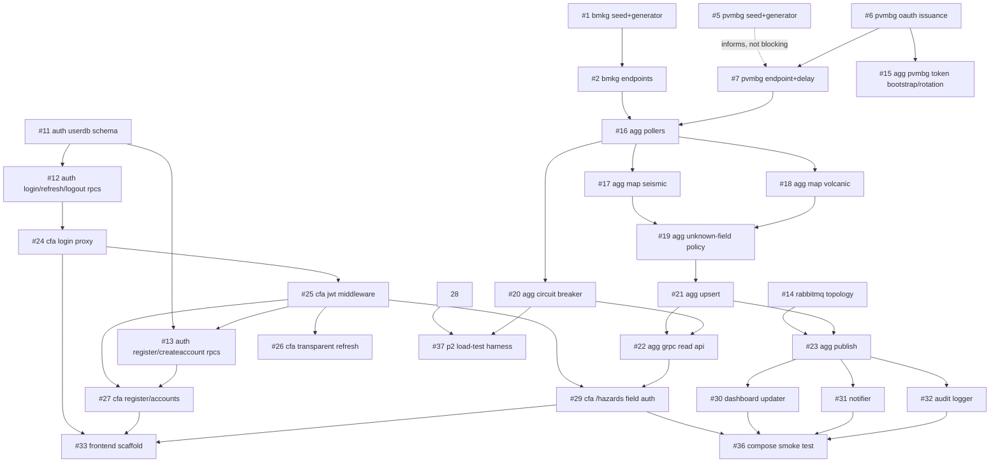

# Backlog Dependency Graph

Not a schedule — an Activity-on-Node map of the M1 backlog (GitHub issues #1–#37), so anyone can answer "what can I start right now?" without reading every issue's `blocked-by` field individually. Dependencies are set as native GitHub issue relationships (`gh issue edit --add-blocked-by`), visible on each issue itself; this doc is the whole-graph view GitHub doesn't render on its own.

Regenerate after adding/closing issues: `gh issue list --repo brii26/distributed-hazard-coordination --json number,title,state`.

## Ready now (no open blockers)

These have zero dependencies and can be picked up immediately, by anyone, in any order:

- #1 BMKG mock: seed data and background event generator
- #3 BMKG mock: X-BMKG-Key validation
- #4 BMKG mock: structured logging and correlation ID
- #5 PVMBG mock: seed data and background event generator
- #6 PVMBG mock: OAuth token issuance (bootstrap + refresh rotation)
- #11 Auth Service: users and refresh_tokens schema
- #14 RabbitMQ: fanout exchange and durable per-consumer queue setup
- #28 Client-Facing API: concurrency cap and per-client rate limiting
- #34 Cross-cutting: correlation ID propagation across all services
- #35 Cross-cutting: health check depth per service

Once #1 lands, #2 (BMKG endpoints) unblocks — the seed store #2 reads from needs to exist first, so #2 isn't in the "ready now" list even though it has no *other* dependents.

## Full graph

## Notes on reading this

- **BMKG/PVMBG cluster** (#1–#9) is almost entirely parallelizable — the mocks don't depend on each other or on anything downstream.
- **Aggregator** (#15–#23) is the critical path: nothing in Client-Facing API's real data flow (#29 onward) or the consumers (#30–#32) can start until the Aggregator chain reaches #21 (upsert) and #22/#23 (the two things it feeds).
- **Auth Service** (#11–#13) and **Client-Facing API's auth chain** (#24–#27) can run fully in parallel with the Aggregator chain — they don't share a blocker until #29, which needs *both* #25 (JWT middleware) and #22 (Aggregator's read API).
- **#28** (rate limiting) and **#34/#35** (cross-cutting logging/health) are deliberately unblocked — they touch every service but don't require any other issue to land first; fold them into whichever issue you're already touching rather than treating them as a separate pass at the end.
- **#36/#37** are integration-level checks — by design, the last things that can go green, since they need real pieces on both sides of the stack.
