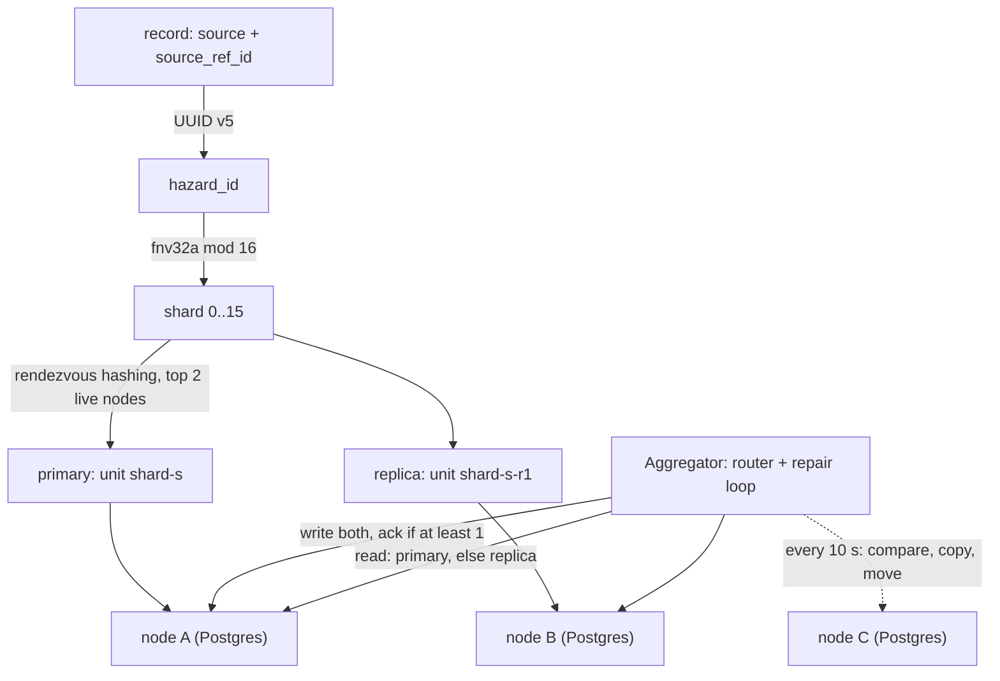

# P1 storage and shard design

Read time: about 5 minutes. This is the agreed design for issue #289. Later issues (#290-#298) build on it.

## In one paragraph

Each node runs one plain Postgres 16 pod. Data is split into 16 fixed shards, and each shard is stored on 2 nodes (replication factor 2). The Aggregator does the routing: it decides which nodes own a record, writes to both, reads from one and falls back to the other, and runs a repair loop that heals missing data. No new database product and no Postgres replication setup; only the Go standard library.

**Assumption: the demo cluster has 3 nodes.** Brian agreed on 17 Nov. With 2 nodes and 2 copies, every node would hold all the data and criterion 1 (data spread over nodes) could not be met. The design also works on 2 nodes, but we do not demo that.

## Diagram



## Engine and topology

- Postgres 16 (`postgres:16-alpine`) as a DaemonSet with `role=store`, one pod per node, data on a hostPath (`/var/lib/rancher/k3s/storage/bnpb-store`, one ConfigMap value).
- Requests 512Mi, limit 1Gi, `shared_buffers=128MB`, `max_connections=60`.
- A DaemonSet means a node that joins k3s gets a store pod automatically.
- All 16 shards live in one table as a `shard` column. Same schema on every node. A `shard_state(shard, synced)` table says whether a copy can be trusted for reads.

## Shard key and placement

- `hazard_id = UUIDv5(namespace, source + "|" + source_ref_id)`. Same record gives the same id on every Aggregator, so copies agree and duplicates are caught. It is still a UUID, so old random ids stay valid.
- `shard = fnv32a(hazard_id) % 16`. This never changes for a record.
- `owners(shard)`: score every live node with `fnv32a(shard|node)`, take the top 2. First is the primary (unit `shard-s`), second is the replica (unit `shard-s-r1`). With one live node there is one owner and the shard is under-replicated.
- Rendezvous hashing means that when a node joins or leaves, only shards where it ranks in the top 2 move. Other shards stay put.
- Membership: every 2 s the Aggregator resolves the headless Service `store`, and reads `SHOW bnpb.node_name` from each IP. A node leaves the live set after 30 s unreachable, so a quick pod restart does not move data.

## Writes (rule W1)

Write to both owners in parallel, 1 s timeout each. Success when at least one copy is committed. If one copy is missed, the shard is marked dirty for the repair loop. If both fail, return an error and the caller retries as today.

Why: writes never stop while a node is down. The cost is that a record written during an outage has one copy until repair (seconds). No data is lost unless the surviving node also dies before repair.

## Reads, fallback and partial answers

- By id or location: ask the primary, on timeout or error ask the replica (1 s each).
- Lists, audit events, checksum, counts: for each shard pick one reachable, synced copy, group by node, one query per node with `shard = ANY(...)`, merge the results. Counts use one copy per shard, so replicas are never double counted.
- Pagination: keyset cursor on `(ingested_at, hazard_id)`, one global position. No `OFFSET`, so no repeats or gaps.
- If both owners of a shard are unreachable, the answer is still HTTP 200 with `partial: true` and `unavailable_units` listing the missing units. It never fails and never returns silently wrong numbers.

## Repair loop

Every 10 s (the lease holder if the P2 lease exists, otherwise any Aggregator, it is idempotent):

1. Per shard and owner, compare `count(*)` and an md5 of the sorted ids.
2. If an owner differs from a synced holder (or is new), copy that shard in pages of 500, then mark it `synced`.
3. When both owners are synced, delete the shard from any other node.

Order is always copy, mark synced, then delete. Deleting first would leave a window with one copy. This also handles a node joining (it takes a share) and a node with a wiped disk. Metrics: `store_shards_underreplicated`, `store_repair_rows_total`, `store_shard_rows{node,shard}`.

## Interfaces later issues use

```go
// shard.go
const numShards = 16
func hazardID(source, ref string) string            // UUID v5
func shardOf(hazardID string) int                   // fnv32a % 16
type node struct{ name string; db *sql.DB }
type copyRef struct{ node *node; unit, role string } // "shard-2" / "shard-2-r1"
func owners(shard int, live []*node) []copyRef      // rendezvous top 2

// cluster.go
func (c *cluster) upsert(ctx context.Context, h HazardEvent) (bool, error)
func (c *cluster) get(ctx context.Context, id string) (*HazardEvent, []copyRef, bool, error)
func (c *cluster) repairOnce(ctx context.Context) error

// scatter.go
type partial struct{ Partial bool; Units []string } // JSON: partial, unavailable_units
func (c *cluster) scan(ctx context.Context, q scanQuery) ([]HazardEvent, string, partial, error)
func (c *cluster) counts(ctx context.Context, q countQuery) ([]countRow, partial, error)
```

`store` (today's single-DB type) keeps its SQL and `cluster` calls it per node. So #295 and #297 can be written now against one store and switched to `cluster` later behind the same method names. Config: `STORE_SERVICE=store`, `STORE_DSN_TEMPLATE`, `STORE_SHARDS=16`, `STORE_NODE_GRACE=30s`.

## What each issue builds

| Issue | Builds |
|---|---|
| #290 | `hazardID`, `shardOf`, `owners`, membership, DaemonSet manifest, `shard` column |
| #291 | Dual write (W1) and `get` with replica fallback |
| #292 | Cross-shard read: scatter, merge, keyset cursor, `partial` |
| #293 | Dataset loader, distribution and burst script (shows spread over nodes) |
| #294 | `repairOnce`, `shard_state`, delete after sync, metrics |
| #295 | Audit events and checksum (on one store first, then `cluster.scan`) |
| #296 | Location endpoint on top of `get` |
| #297 | Dashboard counts endpoint and page (on one store first) |
| #298 | Cluster scenario script, after #269, #294, #295, #296 |

Suggested order: #295 and #297 now in parallel, then #290, #291, #292 and #296, #294, #293, #298.

## Rejected alternatives

- Postgres streaming replication per shard: 4-8 pods do not fit the memory, and failover scripts are ours to write.
- CockroachDB, YugabyteDB, Cassandra: Raft needs 3 replicas and recommends more memory than our 1Gi limit; new image, driver and ops.
- Shard by area (geo): the Sunda megathrust belt would put most writes on one node.
- Shard by time range: all new writes hit the newest range.
- `hash mod N` over nodes: nearly every key moves when N changes.
- Consistent hashing ring with virtual nodes: same result as rendezvous hashing with more code.
- Require both copies on write (W=2): with one node down, writes to half the shards fail.
- Primary-only write with async copy: a single-copy window on every write, not only in outages.

## Starting state

P1 starts from an empty store. Rows written before this branch keep their random v4 `hazard_id` and a NULL `shard`, because the upsert `ON CONFLICT (source, source_ref_id)` does not update those columns, so they would be duplicated across nodes. For a local compose DB with M1 data, wipe the volume once: `docker compose rm -sf canonical-store && docker volume rm distributed-hazard-coordination_canonical_store_data`.

## Rollback

With one store node, `cluster` behaves like the single-DB version (every shard has one owner). Rollback is to pin the DaemonSet to one node or revert the #290 PR.

## Kubernetes

`deploy/store.yaml` lives in namespace `sistem-informasi-kebencanaan-bnpb`. It reads Secret `store-credentials` keys `user` and `password` (created by #270 from `.env`). ConfigMap `store-schema` is owned by P1 and built from `services/aggregator/migrations` (`001_hazard_events.sql`, `002_shard.sql`); #270 only adds it to the kustomization. Memory stays 512Mi requests / 1Gi limits and `shared_buffers=128MB`. The hostPath `/var/lib/rancher/k3s/storage/bnpb-store` sits under the folder the Tester Agent `wipe-node` empties, so a wiped node loses its store data and the recovery code has real work to do.

## Loading the earthquake catalog and the skew

`tools/load-quakes` reads the catalog (CSV or JSON, columns named with `--map`), checks and cleans each row, and sends batches of up to 500 to the Aggregator's `POST /internal/admin/ingest` (admin token). The route runs the poller's own mapping, parking and dual write, but moves no cursor, takes no lease and publishes nothing, so old events raise no alerts. `--burst N` sends N events inside one box (the Sunda arc by default) with times in the last 24 hours. With `AUDIT_TOKEN` set the tool prints how many events the Audit API gained and fails if that is fewer than were sent.

`tests/p1/distribution.sh units` prints primary units, replica units and rows per node from `store_shard_owner` and `store_shard_rows`. `tests/p1/distribution.sh watch 180 10` prints the writes each node took, from `store_node_writes_total` summed over the Aggregator pods.

How the system treats uneven data: the shard comes from the hash of the id, not from the place or the time, so a burst in one region does not land on one node. Measured on the local 3 node cluster with a synthetic catalog (2,000 events, 80 percent inside the Sunda arc, then a 3,000 event burst inside it over 3 minutes): the units were 8, 13 and 11 per node (primary and replica), and the writes were 25, 41 and 34 percent. Each event is written to two nodes, so a node's share of writes follows the number of units it holds (8, 13 and 11 of 32), not where the quakes are. The remaining unevenness comes from 16 shards over 3 nodes. The real catalog is only given at the demonstration, so these numbers are synthetic.

`store_shard_owner` shows where each unit should live, computed from the live nodes, not where the rows are right now. During a repair the units table and `store_shard_rows` can disagree until the rebalancer has finished. The loader checks every sent id against the Audit API (recent events first, the whole source if one is missing), so the live BMKG feed cannot hide a lost row.
