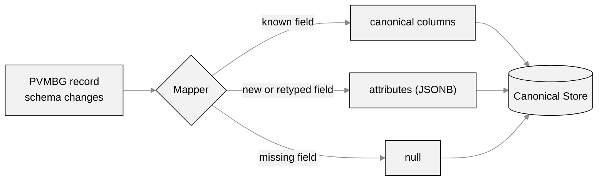
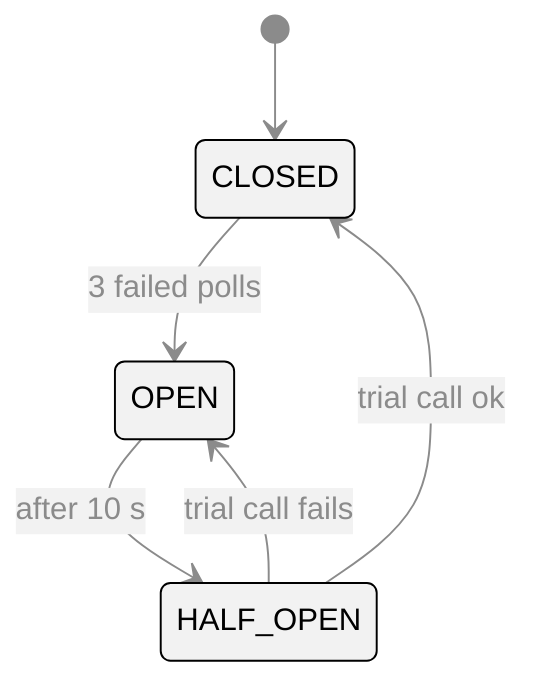
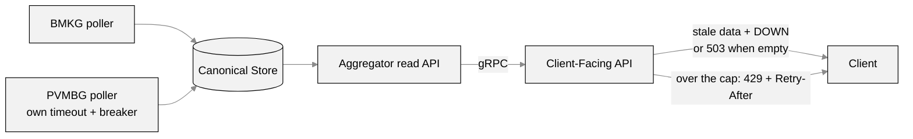
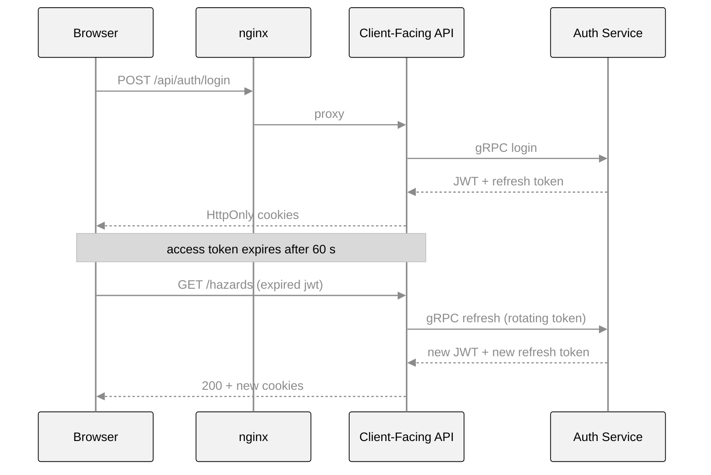
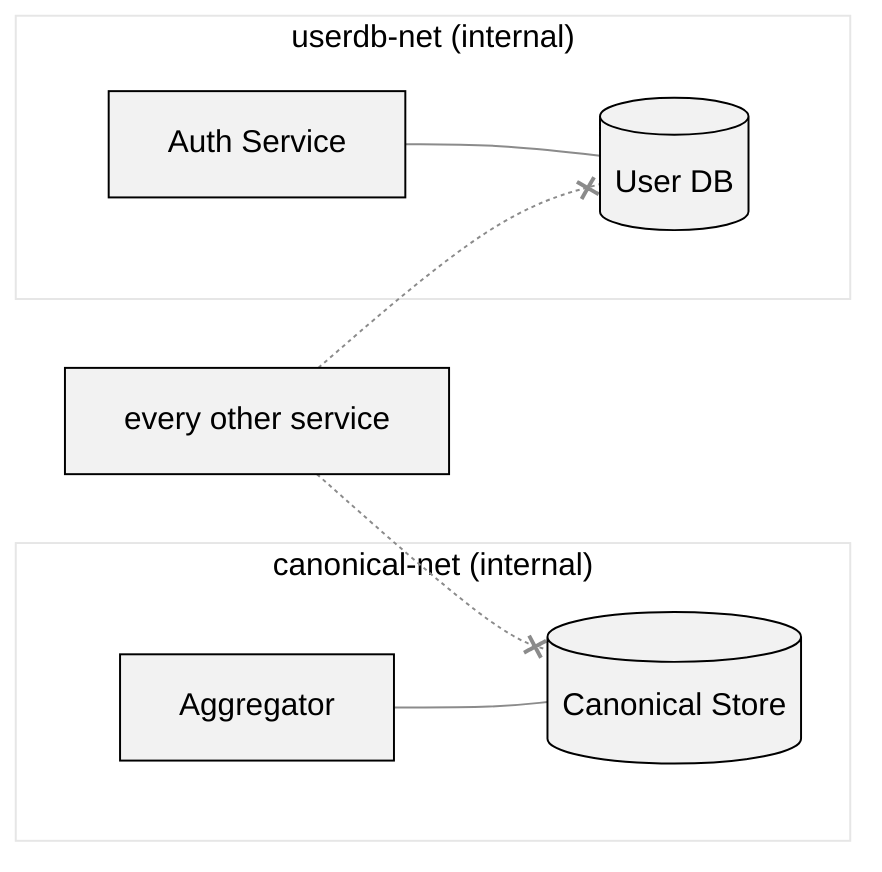
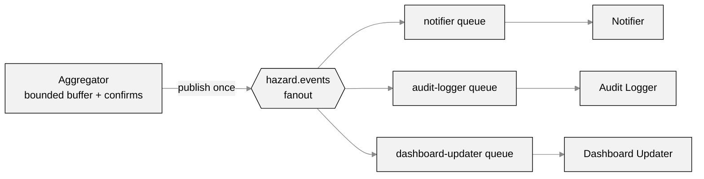

# The five Milestone 1 problems

Each problem is solved in the code and reproduced by a script in `tests/scenarios/`. The steps are in [TEST_SCENARIOS.md](TEST_SCENARIOS.md).

### Problem 1: the source changes its schema and nothing restarts

- Unknown fields go to a JSONB `attributes` column, so the table never needs a migration and the Aggregator never restarts.
- Old rows stay as they were. A field that changes meaning, or a moved endpoint, is a documented limit.

Problem 3 schema policy: a PVMBG record must carry all six contract fields with their contract types. A record that misses one, sends `null`, or changes a type is rejected with a `schema_incompatible: ...` reason instead of being stored with nulls. New fields still go to `attributes`, and BMKG keeps the tolerant policy above. See [doc/P3_SCHEMA_POLICY.md](doc/P3_SCHEMA_POLICY.md).

---

### Problem 2: a slow or failing source must not drag the others down

- One poller, timeout and circuit breaker per source. Reads come from the store, so an outage costs freshness and not availability.
- Overload is shed on purpose: a global concurrency cap, a token bucket per account, and a cap on the gRPC read API.

---

### Problem 3: authentication and per-field access

| Role | Fields | Accounts |
|:---|:---|:---|
| Media | summary only, 403 on raw fields | none |
| Tim Lapangan | all | none |
| Operator | all | can create |

- BMKG takes a static key. PVMBG uses OAuth with a one-time code and rotating opaque tokens that the Aggregator renews by itself.
- Only the Client-Facing API verifies the JWT.

---

### Problem 4: independent services and storage ownership

- Every component is its own container and image, with a `/health` that reports depth. One can be stopped, rebuilt and restarted while the rest keep running.
- Each database is reachable only by its owner and publishes no host port.

---

### Problem 5: event fan-out to independent consumers

- One publish reaches every consumer through its own durable queue. A stopped consumer's queue keeps the backlog and it catches up on return, while the others carry on.
- Consumers acknowledge after processing (at-least-once), so each one deduplicates. A new consumer only declares a queue on the exchange, with no change to the producer.
